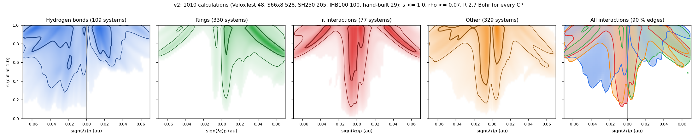
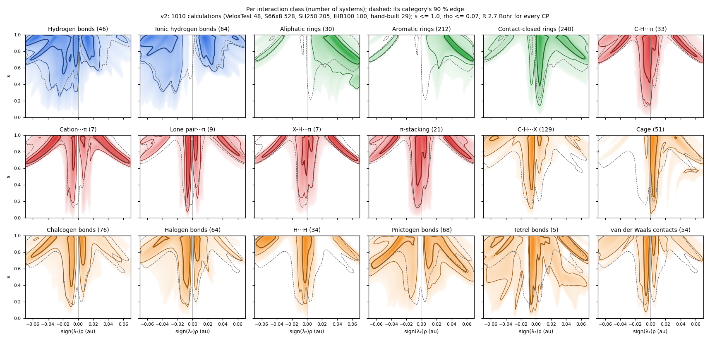

# VIAMD
Visual Interactive Analysis of Molecular Dynamics

VIAMD is an interactive analysis tool for molecular dynamics (MD) written in C/C++. VIAMD is developed at the PDC Center for High Performance Computing (KTH, Stockholm). It exposes a rudimentary scripting language for declaring operations performed across trajectory frames.
The results can then be viewed in the different windows exposed in the application. 
<p align="center">

</p>

## Status
[](https://github.com/scanberg/viamd/actions/workflows/windows.yml)
[](https://github.com/scanberg/viamd/actions/workflows/ubuntu22.yml)
[](https://github.com/scanberg/viamd/actions/workflows/ubuntu24.yml)
[](https://github.com/scanberg/viamd/actions/workflows/macos.yml)

## Running VIAMD 

### Windows
For Windows, we recommend using the latest binary available on the [release page](https://github.com/scanberg/viamd/releases/).

### macOS
For macOS, we recommend using the latest binary available on the [release page](https://github.com/scanberg/viamd/releases/).

**NOTE:** To be able to run this, you will have to do some magic in a terminal to be able to run the app bundle since we do not have code signing.

```xattr -dr com.apple.quarantine viamd.app```


### Building for Ubuntu and macOS
To [build](https://github.com/scanberg/viamd/wiki/0.-Building) VIAMD on your machine, you can follow the procedure described in detail in the wiki for [Linux](https://github.com/scanberg/viamd/wiki/0.-Building#linux) and [MacOS](https://github.com/scanberg/viamd/wiki/0.-Building#mac).

On macOS, VIAMD builds without Xcode: CMake and the macOS Command Line Tools are
enough. If Apple's Metal compiler happens to be available, the Metal compute
kernels are compiled to `.metallib` during the build; otherwise VIAMD embeds the
shader source and compiles it with Metal's runtime shader compiler on first use,
which costs a fraction of a second at startup and is otherwise identical. Xcode
is only needed if you are changing the offline Metal shader compilation pipeline
itself.

## Documentation
Documentation about VIAMD is available on the github [wiki](https://github.com/scanberg/viamd/wiki). The first two chapters relate to the [visual](https://github.com/scanberg/viamd/wiki/1.-Visual) and [analysis](https://github.com/scanberg/viamd/wiki/2.-Analysis) features, respectively, where we highlight the interactive part of the software. The third chapter focuses on the VIAMD [language](https://github.com/scanberg/viamd/wiki/3.-Language) used for scripting, and the fourth chapter proposes a series of [tutorial](https://github.com/scanberg/viamd/wiki/4.-Tutorials) (under construction). 

A series of videos is available on [youtube](https://youtube.com/playlist?list=PLNx9MpJY8ffr9CeK7WefdOnuGRw_E5rSj&si=VatBHEwiL7jWyhPK).

### Critical-point density distributions
The critical-point search is enabled by default; uncheck Enabled to stop it.
The Critical Points window has independent CP and NCI columns. The CP column
contains the density distributions, chemical-environment table, point list and
selected-point details. Chemical analysis and NCI can each be disabled
independently. The NCI scatter plot and its layer panel share the Critical Points
window; the layer list and selected-layer inspector are below the plot.
Disabling NCI stops its computations and hides surfaces without deleting saved
layers or changing their settings. CP settings/export and distribution filters
open from compact buttons. Scatter hover details show the source layer/family,
signed density, s and click hints. Drag the splitters and column borders to
resize the panels. Extra table columns are
hidden by default and can be enabled through the header context menu. Existing
saved column layouts are preserved; Compact columns applies the new concise
layout to an existing table.

Chemical analysis can be switched off independently of the CP search and NCI.
This stops chemical-environment classification and chemistry-dependent
descriptors; NCI continues using CP positions and selection, grouping
unclassified anchors as **Unassigned**. The chemical-environment table,
chemistry-grouped CP list and chemical details are unavailable until analysis
is re-enabled. Chemistry-dependent filters and BCP character filters are
ignored while it is off; density filters remain active.

The distributions cover attractors, bond critical points, ring critical points,
and cage critical points. Each panel uses the category's marker color and an
independent logarithmic electron-density axis (au, e bohr^-3). Repeated axis titles
are hidden to save space; numeric ticks remain because each category has its own
scale. The filled curve is an adaptive nearest-neighbor Gaussian estimate in log10 density, normalized
to unit area per decade, not a histogram or an electron density. Categories
containing zero or negative densities use a linear axis and probability per
density unit instead. Each curve is split into stacked colored layers, one per
chemical environment (the five largest in view, the rest pooled as Other environments);
the layers sum exactly to the category's total curve, drawn as a line on top.
There is no legend: the tables' environment swatches use the layer colors.

Bars along the bottom show the actual critical points. Bars within six screen
pixels are grouped, with a count label, so degenerate values remain visible.
Bar height is directly proportional to the group count within each panel, with
the tallest bar's count displayed as a scale reference. Bars whose CPs share one
environment take its color; selected and highlighted bars use the viewport's
selection and highlight colors.

Density plots follow the Distributions window's navigation: mouse-wheel zoom,
left-drag pan, and double-click to fit the density axis. The vertical axis
auto-fits; density-axis zoom persists until refitted or new search results arrive.
Dragging to pan does not select a bar or clear the selection.

Each plot's curve is split into peaks at its valleys, the deepest first
(persistence), into at most six, coloured in the plot. Zooming refines them: a
zoomed plot draws the curve of the CPs in view at the view's resolution (the
overview's curve stays as a faint line), and its peaks split at that curve's
valleys, again into at most six in view, numbered after the overview's peak
they lie in (2.1, 2.2) in shades of its colour. The viewport's Colour menu can
colour the CPs by their peak.

The environments table is organised by chemistry, not by peaks: one row per
Type, Kind, Chemical environment and, for BCPs, Character, in that order. A row
never mixes characters, and the kind and environment are written once for the
character rows that follow. The Detail menu sets how finely environments are
named: the group ("C aromatic"), then what the atoms are bonded to ("C aromatic
[C2H]", "H (on N [C2H])"; a contact ring's size and composition), then their
residues where the system has them ("in PHE", "between GLY and SER"). Auto, the
default, picks for each category and kind the finest level that gives at most
six environments. The Distribution column draws each row's CPs as a small
histogram along its plot's axis, following the plot's zoom, coloured by
character (other CPs in their category's colour). Grey arrows mark CPs outside
the view, so the peaks show up within each environment without splitting the
rows. Share is the row's fraction of its category's listed CPs. Sorting applies
within categories. The details pane always shows the finest name. The CSV
export includes each row's character and share.

Each category has an independent, optional density filter made of one or more
inclusive ranges; a point passes if it lies in any of them (their union). The
filters are the chips above the plots: + Filter (or +) adds a range over the
middle third of the plot's current view (zoom onto a peak first); drag its two
vertical handles in the plot, click the chip to type Min/Max, or press its x to
remove it. The line shows how many CPs pass. Accepted ranges are shaded; excluded
bars are dimmed, and a partially accepted group has a bright segment
proportional to its passing count. Only points whose category is shown and
whose density passes its filter appear in the viewport or take part in viewport
picking, region selection, or view fitting; paths from excluded points are
hidden too. Filtering does not recompute the search or change the topology export.

The Plot selector above the filters chooses what the plots show, their peaks
group by and new filters select by: density, the energy density H = G + V, the
ratio |V|/G, an empirical hydrogen-bond energy E(HB) (Emamian et al. 2019 by
default, Espinosa et al. 1998 selectable; only for contacts classified as
hydrogen bonds), the Mayer bond order, or an approximate interaction energy
E(int) = qA qB / R - BO / (2R) from Mulliken charges and the bond order
(kcal/mol, negative favourable; a crude stand-in for an IQA pair energy). The
energy descriptors come from the analytic search only. G is computed at each CP
from the density matrix, and V follows from the local virial theorem. The bond
orders and charges need the overlap and density matrices. Filters are kept per
variable, and a CP must pass each enabled one. CPs without a value of the
plotted variable are left out of the Distribution column, whose tooltip counts
them and gives the reason. Each BCP also gets a Character from a non-covalent
interaction (NCI) analysis of the density, the same for every interaction. The
region around the BCP, on the surface between its two atoms, where the reduced
density gradient s ≤ 0.5 and ρ ≤ 0.05 au, is split by the sign of λ2. Negative
λ2 means attractive (density accumulates), positive means repulsive (density
depleted, steric crowding). Below 0.01 au, λ2 is near 0 and its sign means
little (NCI's green band). A region mostly below that density is Weak: mostly
dispersion, which the density does not capture, so it only gets a lean from the
density-weighted repulsive share of that weak part: an attractive lean
(< 35 %), a repulsive lean (≥ 65 %), or Weak, no lean, in between. Otherwise the
density-weighted repulsive share of the denser part decides: Attractive
(< 25 %), Mixed (25–50 %) or Repulsive (≥ 50 %). A BCP with ρ > 0.05 au is
beyond NCI's range: Covalent between bonded atoms, Attractive (strong) between
atoms that are not, such as a short, strong hydrogen bond.
One with no region is Undetermined. The thresholds are conventions, and "NCI repulsive share" can be plotted and filtered. The
BCPs line above the filters hides characters, and the viewport's Colour menu
can colour BCPs by character.

The analytic mdlib evaluator also provides the local Pauli kinetic energy
density t_P = G - |grad rho|^2 / (8 rho) at arbitrary points, with G, rho and
its gradient computed in one AO pass. At a critical point t_P equals G, so
there is no duplicate CP column. This is a total-density local descriptor,
not a fragment interaction energy or a repulsion classifier. It is not
used by the NCI character rules or exposed as a surface. The analytic contact
job samples it on the accepted, projected NCI region and retains density-weighted
means of t_P and of t_P / tau_TF, where tau_TF = 3/10 (3 pi^2)^(2/3) rho^(5/3).
These are local means over a projected disk, not a 3D integral or an interaction
energy. All region samples must be valid; incomplete evaluation leaves the
means unavailable with a reason. Dense contacts outside NCI's sampling range
have no regional measurement. Nonpositive density
(including screened vacuum) gives an undefined value (NaN); small negative
roundoff values are not clamped.
Neither mean has a universal clash threshold. In particular, normalization by
tau_TF can amplify dilute regions: at fixed orbital shape, scaling the density
by c scales t_P by c but t_P / tau_TF by c^(-2/3). Hydrogen-bond and crowded-contact
values can overlap; a large normalized value alone does not establish repulsion.
The Distribution variable selector exposes **Regional Pauli (experimental)**
and **Regional Pauli / TF (experimental)**, with the usual per-variable filters
and distribution/peak colouring. Both tables offer optional columns, hidden
by default (right-click a table header to enable them), marked with an asterisk
for experimental descriptors. Details show the regional values and sample
count, or the reason they are unavailable. CSV exports include both values;
the CP export also records valid samples and status. Environment and parent
means give each CP with a valid regional measurement equal weight, rather than
pooling the samples of regions of different sizes; their tooltips and exports
give the valid CP count.
Pauli remains automatic with the analytic contact analysis. Projection batches
reuse unchanged point values and omit points already excluded by the projection;
the kinetic evaluator shares the blocked density-matrix product used for density
derivatives. The energy/contact job uses atomic cancellation through mdlib's
cancellation callback, with additional checks between batches and during regional
processing. Cancelled or stale job results are not published.
Mulliken populations also supply the electron-count trace without another
density/overlap matrix pass; population and bond-order work honour the same
job cancellation.

NCI follows VIAMD's layer controls: its compact list and inspector sit below the
interactive scatter plot. **Full system** and **Preview** are listed first;
saved layers follow below a separator line. Selecting any number of CPs updates
the Preview, and **+** saves it as one layer, whatever CP types it holds. A new
layer is named by the CP families it holds ("Hydrogen bonds", "Hydrogen bonds +
π-stacking", "Aromatic rings + 2 more"), numbered if the name is taken. Each
row shows its CP types with their CP counts (for example "Hydrogen bonds 2,
π interactions 1"). Clicking a row shows that layer in the viewport and hides the
others (one at a time); clicking the shown row again hides it. The eye only
shows or hides the layer in the scatter plot, any number of them. A new CP selection shows the Preview; clearing
it returns to the Full system unless a saved layer is shown. Saved layers can be
renamed, reordered and recoloured (the chip colours their scatter outline).

The surface is the chosen isovalue of the reduced density gradient s where ρ is
below the cutoff, coloured by sign(λ2)ρ: negative attractive, near-zero weak,
positive repulsive. The default Jet palette maps these to blue, green and red.
Density is sampled on a grid (Coarse 0.3, Medium 0.2 or Fine 0.13 Bohr) and
differentiated by finite differences. A finer grid is smoother and more accurate,
but takes longer. Connected regions keep six-connected low-s components seeded
near anchor CPs; a uniform 2.7 Bohr radius cap limits their extent. This segmentation
depends on grid resolution and thresholds and is not a unique physical
partition. Regions without an anchor are excluded.

Every CP-anchored layer, including Full system, uses the reference extraction:
**s ≤ 1.0, ρ ≤ 0.07, R = 2.7 Bohr**, both signs of λ2, connected regions and
nearest-CP ownership. There is no CP-adaptive mode or per-type radius. These
extraction parameters are fixed, not display controls.

The **NCI settings** (gear button) adjust the **surface isovalue**, resolution,
opacity and colour scale. The surface isovalue defaults to **0.7** and can be
lowered for a clearer surface; it does not change the scatter samples or reference.

The NCI types come from the CP classification: a contact CP's type is its
branch under Contacts in the CP tree. Hydrogen bonds (including ionic ones and salt bridges) and σ-hole bonds (halogen,
chalcogen, pnictogen, tetrel, triel, aerogen) are their own types; π···π, C-H···π,
X-H···π, cation/anion/lone pair···π and π-hole bonds are all π interactions, so every π
contact shares one type; the remaining contacts (C-H···X, H···H, dihydrogen, metal,
ion pair, van der Waals, ...) are other contacts. Rings
and cages keep their own types. Bond, bond-path and attractor CPs
anchor no NCI surface, because their density is far above any NCI cutoff. CPs in
the same interaction region share the same parameters. A ring closed by π···π
keeps the π-interaction type for classification, but uses the same extraction
radius as every other CP. The surface and scatter share the density cutoff,
radius and ownership rule; only the surface's display isovalue is lower than
the scatter cutoff. In the graph a **dashed line at s = 1** marks the
reference/scatter cutoff, while a separate movable **surface isovalue** line
marks the displayed surface. Defaults are defined in
`src/components/topology/nci_surface_core.{h,cpp}`. These regions do not assign
a unique physical extent to an interaction.

One colour scale applies to every NCI surface: one palette (Jet by default) and
one range, symmetric around zero with zero at the palette midpoint, and one
legend in the viewport. Auto follows the span of the shown layer; a manual range
fixes it for comparisons. Outliers saturate in colour; changing the colour
scale does not recompute geometry.

Selecting a CP or chemical environment also outlines its contribution to the CP
density distribution in the selection colour. This is the selected subset's
share of the category's original density estimate, not a separately normalized
distribution.

The **NCI scatter** plots reduced density gradient s against sign(λ2)ρ. A
full-system context cloud is computed while NCI is enabled and the Critical
Points window is open, even with the CP search disabled. The shown layer's
samples are plotted per interaction (a ring closed by π···π counts as a
π interaction), and hovering a point identifies it. The legend is a centred row of
chips under the plot. Click a point or an interaction's name to make it the
active one for the guides: the isovalue and colour-range lines.
Dragging the isovalue line edits the isovalue of every layer; the line is in
the layer's colour. Each interaction always has the same colour (hydrogen
bonds blue, π interactions red, rings green, σ-hole bonds purple, other contacts
orange, cages brown); layer colours are chosen apart from those. Outlines
indicate a mass level of a smoothed sample density, not a physical region
boundary.

The scatter and its layers follow the Ramachandran window's layout. Each row
has an eye (shown in the scatter plot or not), a swatch of how it is drawn, its
name and a line of detail; clicking a row selects it, and its properties are
set in the inspector below the list. The **Full system** is the CP reference:
like any layer, it can stay drawn under the shown layer. A **Reference** row
above the layers shows the built-in reference map, independent of the loaded
system: per CP category (hydrogen bonds, rings, π interactions, other), the pooled
(sign(λ2)ρ, s) density of uniform reference extractions (s ≤ 1.0 as a hard cut,
ρ ≤ 0.07, R = 2.7 Bohr around every CP, both signs of λ2, each sample to its
nearest NCI CP) over 1010 VeloxChem calculations (B3LYP-D4/def2-SVP), each
system weighing the same: the S66 dimers at their eight S66x8 separations (each
dimer weighs one system); the SH250 σ-hole set (halogen, chalcogen and pnictogen
bonds; its 45 dimers with I, Te or Sb, which need effective core potentials,
are left out); the IHB100 ionic hydrogen bonds; 29 hand-built systems for the
rarer classes (cation···π, anion···π, lone pair···π, tetrel, π-hole and
dihydrogen bonds, coordination, ion pairs); and 48 larger test calculations
(protein, G-quadruplex, cages, helicenes, etc.), which add the strained
intramolecular contacts small dimers lack. The same rule applies to every CP, so
the reference matches what the scatter plot of a system shows; contacts denser
than ρ = 0.07 at the bond (the strongest ionic hydrogen bonds) fall outside it,
and the 2.7 Bohr sphere also holds the tails of nearby covalent density, the
diagonal wings at |ρ| > 0.03.


Its inspector sets the style (**Combined**, default: the categories' colours
mixed where they overlap, more opaque towards each core; **Dominant**: per point
the densest category, more opaque at each deeper level; switching
style turns lines on for Dominant and off for Combined), the opacity (60 % by default),
fill and lines, the line width and the levels (by default 50, 90 and 98 % of
each category's volume; drag a level, right-click to remove it, + to add one).
Hovering the plot inside the reference lists its categories there from the most
likely, each with its share of the categories' reference densities (each
category weighing the same) and the smallest drawn area enclosing the point; a
hovered sample's tooltip adds the same lines, each category followed by its
subfamilies' part of its share. The collapsed **Interaction guides** section in
the Reference inspector has **Add interaction guide...**: browse all available
maps grouped by category, or search by name or chemical description. Hover an
entry for a short explanation and its number of supporting systems. The optional
**Other recognised interactions** section lists classes without a standalone map
(fewer than 5 supporting systems); these cannot be selected. Expand a class to
choose **Whole class** or its finer maps: donor/acceptor and intra/intermolecular
hydrogen bonds, ring size/composition and contact-closed rings, element-pair
and intra/intermolecular refinements of every other contact class, and cage
subtypes. The baked reference has 18 whole-class maps and 88 finer maps; only
refinements with at least five supporting systems are offered.
Only selected guides stay in the inspector, with visibility and remove controls;
**Clear** removes them all. Each guide draws only its **90% volume isoline**, in
a shade of its category's colour, and has a `Ref:` legend entry whose swatch
toggles it. These outlines are independent of the category map's visibility,
opacity and levels: hide **Reference** to see just the selected guides.
The default scatter view spans **s = 0 to 1.1**, leaving headroom above the
cutoff. Double-click and the fit button restore that range, not s = 2.
Saved previews inherit their deepest shared chemical-environment name, such
as **N–H···O** or **Br···O**, without the descriptive CP prefix or atom-environment
annotations. Ring and cage selections likewise use their chemical subtype.
Mixed selections fall back
to a shared branch or a combined name.
Each layer row reports the share of its category samples inside their
category's 90 % area, whatever levels are drawn, by category in its tooltip and
inspector. The map is generated with `tools/nci_reference` (`run_batch.py`, then
`nci_reference_regions.py`, whose `--group` makes several exports share one
system's weight, and `subfamily_regions.py` for the subfamilies, then
`bake_reference.py --subfamilies`); `validate_regions.py` reports how
much of a test set's volume falls inside a map, and `plot_regions.py` draws
the figures here. Other wave functions may shift it.



A layer's inspector sets its name (saved layers), style (**Contours**: the
outline of all its samples together at each level, optionally filled, stacked
per level; **Heatmap**: the density of its samples), colour, opacity, fill and
lines, line width and levels (90 % by default). Points always take the colour
scale of their surface in the viewport, so a colour means the same density in
both; layers are told apart by their contours. Only the layer shown in the
viewport plots points. The Delete key or a row's context menu removes a saved
layer. Clicking one of the shown layer's points makes its interaction the
active one for the guides; clicking it again hides them. Layers not shown in
the viewport are drawn from their last computation, under the shown one. The
legend under the plot repeats the reference and the layers with their swatches;
clicking one shows or hides it. **All samples** in the legend toggles the
context cloud. **Guides** also toggles the isovalue and colour-range lines; on
the right, ⤢ fits the view and the gear sets the interaction line width and the
point size, and **Interaction isolines and areas** (off by default) adds
per-interaction isolines and areas in every layer, with a legend square each:
click it to toggle, right-click for its isolines and area or those of all
interactions, click its name to make it the active one for the guides.

Saved NCI layers last for the current loaded geometry; they are cleared when
the dataset is reset and are not saved to disk. The NCI settings are kept for
the session. **Show CPs in
viewport** hides markers, paths and labels without changing selection, tables or
NCI layer membership.

Up to 50,000 volume samples with s ≤ 2 are retained per extraction by
deterministic reservoir sampling, not a population or interaction-energy measure.
Radius-only samples are independent of the surface isovalue. Connected-scope
samples cover the selected low-s components and their one-voxel halo, so they
follow changes in the isovalue. Spatially distinct layer samples may overlap in
the plot. These display controls do not change the CP character-classification
thresholds.

The environments table is a collapsible chemistry hierarchy of the CPs of the
shown categories that pass their filters. Type is the first column and
Chemical environment the second; the tree starts at chemistry branches,
without an extra Attractor/BCP/RCP/CCP dropdown. BCPs split into Bonds, Contacts and
Bond paths with unknown connectivity. Bonds group by element pair (C-C, C-N,
etc.); Contacts by interaction family (Hydrogen bonds, pi-stacking, etc.)
and pair, with donor-H...acceptor groups for hydrogen bonds. Ring CPs group
into aromatic, aliphatic, sugar or contact-closed rings when recognized.
Detail still controls the environment names at the leaves. Every leaf repeats
its environment name, even when separate characters share a name.
Character remains a column, not a branch: neither density peaks nor the NCI
character determine the chemistry hierarchy.
Kind is omitted from this table because the branches already identify it;
it remains in the individual CP list and CSV exports.

Parent rows summarize all listed descendants, including collapsed ones:
count, share of the CP category, a character-stacked distribution, density
range and means of Laplacian, ellipticity and energy descriptors. Means use
all descendants with a value, not averages of the child means. A parent
with several characters says Multiple, not the NCI classification Mixed.
Arrows expand/collapse without selecting. Collapse all, Expand all and
Reveal selection control the tree.

The critical point list below it shows the CPs of the environments chosen in
the table above, else of the bars clicked, else every CP the environments table
counts (List all returns to that), with the same first columns (Type, Kind,
Chemical environment, index) and then density, Laplacian, ellipticity and
position. Both tables sort by clicking a header, Shift-click further headers to
sort by several columns; the environments tree sorts siblings without
separating their descendants. Right-click a header to hide columns (Type and
Chemical environment always stay).

The Export menu at the top writes two kinds of data. Topology (JSON or VTP) is
every critical point and path, unfiltered and without chemical labels, for scripts
and ParaView. Chemical analysis (CSV) is either table as listed and sorted, every
column at full precision (hidden ones too); the environments export all
filtered leaves in tree order, including collapsed ones, with a hierarchy path
and their CP indices (parent summaries are omitted to avoid double counting),
the CP list each CP's label detail, and the CP index joins it to the topology
export.

Selection works at both levels. Click an environment or a parent category to
select all its listed CPs, even in collapsed descendants. Ctrl-click or
Shift-click adds the whole group, or removes it if it is fully selected.
Hovering a parent highlights all its listed descendants. Its environments
are listed below and its CPs become the selection. Click a
bar to list and select its CPs, Shift-click to add. In the list, click a CP to
select only it, Shift-click to add or remove it, Shift-right-click to remove it;
the list itself stays. CPs picked in the viewport join the same selection, and a
plain click on empty plot space (or viewport) clears it. Hovering only
highlights, everywhere, with no tooltips.

The last CP clicked in the list (or the only selected CP) is explained in the
details pane and ringed in the viewport. Show sets what the viewport does with
the selection: Selected CPs (the default: every other CP is hidden and cannot be
picked), All CPs (the other CPs only lose saturation, as selections do elsewhere
in VIAMD), or Selected + 3 Angstrom (other CPs within 3.0 Angstrom of a selected
one keep full color, the rest are dimmed to 15% opacity). Selected CPs carry a
selection ring. With nothing selected every CP is shown. Category visibility and
density filters still apply.

Next to Show, Environment colours fills the viewport markers with their chemical
environment's colour (the one of the plots and tables) instead of their
category's, and Labels names the environment of each selected CP beside it in
the viewport (at most 200).

The details give the CP's type, density, Laplacian (and for a BCP, shared-shell
or closed-shell), Hessian eigenvalues, ellipticity, position and why it got its
label.

Every label has a kind, shown in its own sortable column of both tables
and as a prefix elsewhere ("Bond: C aromatic – C aromatic"):

- Atom: an attractor with exactly one nucleus within 0.30 Angstrom, and no other
  attractor competing for that nucleus. Labels use the existing element,
  aromaticity, double-bond, and hydrogen metadata (C aromatic, C/O carbonyl,
  O/N (H-bearing)); hydrogens are named by the atom they are bonded to (H (on C)).
- Bond (–): a BCP whose two traced attractor endpoints are atoms bonded in the topology.
- Contact (···): the same, for atoms not bonded in the topology, classified from
  elements, connectivity and geometry, and tagged intramolecular or intermolecular
  when molecules are known:
  classified in this order (group charges are md_chem's formal charges summed over
  bonded charged atoms, so a nitro group is neutral; an isolated metal counts as a
  cation and an isolated halogen as an anion):
  - H···H: Dihydrogen bond when one H is hydridic (on B/Si/Ge or a metal, or an
    unbonded hydride) and the other on N/O/F/S/Se/halogen, else H···H.
  - H···Y: Agostic (C–H to a metal), Hydride bond (hydridic H), Metal contact (other
    H to a metal), then, with D–H···Y above 110 degrees (else van der Waals contact):
    an H on N/O/F/S/Se/Cl/Br/I to N/O/F/P/S/Se/Cl/Br/I or a terminal C≡ (cyanide, CO)
    is a Salt bridge (cationic donor group, anionic acceptor group), an Ionic hydrogen
    bond (either charged) or a Hydrogen bond; towards a π face (aromatic atom or sp2/sp
    C) it is Cation···π (cationic donor group), X–H···π or C–H···π; an H on C to an
    acceptor or an anion is C–H···X. An unbonded hydride to a metal is an Ion pair.
  - Triel bond: a trigonal B/Al/Ga towards a nucleophile.
  - With a metal: Metal···metal, Ion pair (opposite charges), Cation···π, Coordination
    (to a lone pair), else Metal contact.
  - σ-hole bonds: Halogen, Chalcogen, Pnictogen, Tetrel or Aerogen bond when the
    largest R–X···Y angle is above 140 degrees (tetrel: sp3 C above 160 degrees)
    towards a nucleophile Y; Halogen···halogen (type I) when both C–X···X angles agree
    within 15 degrees.
  - A charged group over a π face: Cation···π or Anion···π.
  - π-hole bond: a lone pair over the π* of a C=O, N=O, S=O, P=O or C=S (70–130
    degrees to the double bond).
  - π···π (aromatic or sp2/sp B/C/N/O/S atoms on both ends), Lone pair···π, Ion pair
    (opposite group charges), else van der Waals contact.
  In the NCI layers, Hydrogen bond, Ionic hydrogen bond and Salt bridge are hydrogen
  bonds; π···π, X–H···π, C–H···π, Cation/Anion/Lone pair···π and π-hole bonds are π
  interactions; Halogen, Chalcogen, Pnictogen, Tetrel, Triel and Aerogen bonds are
  σ-hole bonds; Halogen···halogen, Dihydrogen bond, Hydride bond, Agostic,
  Coordination, Ion pair, Metal···metal, Metal contact, C–H···X, H···H and van der
  Waals contact are other contacts.
- Bond path (~): the same, when the system has no connectivity.
- Ring: an RCP within 0.50 Angstrom of the centroid of exactly one perceived ring
  (3-7 atoms), named by aromaticity, size and composition ("Aromatic 6-ring C6").
  Otherwise it is matched to a cycle of bond paths, taken as straight lines between
  nuclei, whose polygon encloses it within 1.0 Angstrom of its plane and whose BCPs
  are all denser than it (a ring CP is the density minimum of its ring's surface).
  Cycles of 3-10 atoms within 5 Angstrom are tried first, then, if none fits, of
  up to 14 atoms within 6 Angstrom (the larger hydrogen-bonded rings of proteins).
  Matching is global: smallest and closest pairs first, each cycle claimed by one
  ring CP. Between free cycles of the same size about as close, the one whose face
  holds no atom of the others wins, else the smallest by area; if the two smallest
  differ by less than 15% the ring CP is tied. With the analytic search, a tied
  ring CP's ring surface is then traced in the background (the gradient paths
  leaving it in the plane of its two positive curvatures, bisected down to the
  narrowest sectors) and the cycle holding every nucleus it reaches wins; if none
  or several do, the ring CP stays unassigned. Bonded
  cycles are named "Bonded 8-ring"; cycles closed by contacts are named by their
  strongest contact class ("Closed by Hydrogen bond", in the order Salt bridge,
  Ionic hydrogen bond, Hydrogen bond, Halogen, Chalcogen, Pnictogen, Tetrel, Triel
  and Aerogen bond, Halogen···halogen, Coordination, Ion pair, Cation···π, Anion···π,
  π-hole bond, π···π, X–H···π, Lone pair···π, C–H···π, Dihydrogen bond, Hydride
  bond, Agostic, Metal···metal, Metal contact, C–H···X, H···H, van der Waals contact), with size,
  composition and contacts in the details. A ring CP with a
  density within 2% of a BCP on its ring is marked near-degenerate: the pair is
  close to annihilating.
- Cage: a CCP whose ring-CP paths reach at least 3 faces, all assigned rings
  ("Bonded cage, 6 faces", or "Contact cage, 6 faces" if any face is closed by a
  contact); its composition and faces are in the details.
- Non-nuclear attractor: an attractor more than 0.50 Angstrom from every nucleus,
  named by its two nearest ones.
- Unassigned: everything else, named by its topology ("Unassigned attractor",
  "Unassigned BCP", "Unassigned ring CP", "Cage CP (unassigned)"). Attractors
  0.30-0.50 Angstrom from a nucleus stay unassigned. Missing paths and ambiguous
  rings are not replaced with nearest-atom guesses.

With the analytic search, the details also give the sign of a BCP's Laplacian
(negative: shared-shell, positive: closed-shell) and its ellipticity, which the
tables have as a sortable ε column.

Contact classes name geometry and topology only: they do not establish
interaction energies or stabilization, and do not modify the molecule, other
windows, or the topology export.

## Update
If you want to stay informed about the latest updates of VIAMD, please register your email address on the [form](https://forms.gle/fAxuWob8nMLcrS5h9). 

## Citations:
* General Framework:
  * R Skånberg, I Hotz, A Ynnerman, M Linares, VIAMD: a Software for Visual Interactive Analysis of Molecular Dynamics, J. Chem. Inf. Model. 2023, 63, 23, 7382–7391 https://doi.org/10.1021/acs.jcim.3c01033
  * R Skånberg, C König, P Norman, M Linares, D Jönsson, I Hotz, A Ynnerman, VIA-MD: Visual Interactive Analysis of Molecular Dynamics, 2018, Eurographics Proceedings, p. 19–27

* Specific tool:
  * Selection tool: Robin Skånberg, Mathieu Linares, Martin Falk, Ingrid Hotz, Anders Ynnerman, MolFind-Integrated Multi-Selection Schemes for Complex Molecular Structures, 2019, The Eurographics Association, p. 17-21​
  * Shape Space and Spatial Distribution Function: Robin Skånberg, Martin Falk, Mathieu Linares, Anders Ynnerman, Ingrid Hotz, Tracking Internal Frames of Reference for Consistent Molecular Distribution Functions, 2021, IEEE Transactions on Visualization and Computer Graphics, 28 (9), 3126-3137​

## Financial Support
<p align="center">

 &nbsp;&nbsp;&nbsp;

 &nbsp;&nbsp;&nbsp;

 
</p>

* VIAMD has received financial support since 2018 from the Swedish e-Research center ([SeRC](https://e-science.se/)) and the [Wallenberg Foundation](https://www.wallenberg.org/en)
* VIAMD is currently supported as a development project in [InfraVis](https://infravis.se/)

## Acknowledgements

https://github.com/glfw/glfw

https://github.com/dougbinks/enkiTS

https://github.com/ocornut/imgui

https://github.com/epezent/implot

https://github.com/BalazsJako/ImGuiColorTextEdit

https://github.com/skaslev/gl3w

https://github.com/max0x7ba/atomic_queue

https://github.com/mlabbe/nativefiledialog

https://github.com/nothings/stb

#
<p align="center">

</p>
