# Making movies

VIAMD records a movie of a trajectory. You choose how long it is, place camera keyframes, key look settings (exposure, background, depth-of-field blur and so on) and the properties of representations (show or hide one, change its size or color), and add overlays (text, a time stamp, a scale bar, a time bar, images, plots of trajectory properties, the visualization of a script property, the VIAMD logo). The result is an MP4 (H.264 or H.265) or WebM file encoded by ffmpeg, or a numbered PNG sequence.

Contents: [The editor](#the-editor) · [Shortcuts](#shortcuts) · [Quick start](#quick-start) · [The timeline](#the-timeline) · [Output](#output) · [Timing](#timing) · [Camera](#camera) · [Looks](#looks) · [Representations](#representations) · [Overlays](#overlays) · [Saving](#saving) · [Example workspaces](#example-workspaces) · [Tips](#tips) · [Known limits](#known-limits)

The screenshots below were captured from the current editor on Linux on 12 October 2026, using the [60 s aspirin binding example](examples/aspirin_binding_movie.via). Panel sizes, lane choices and per-key tracking are editing demonstrations, not untouched workspace defaults. The Looks and fullscreen Preview captures use the example's updated aperture-based blur schedule.

## The editor

Open it with **Windows > Movie**. One window holds everything:

- **Top:** playback (**Play Preview**, **Play from start**, **Repeat**), the preview-time scrubber, the **Timeline** and **Controls** boxes (hide either panel; one always stays), **Fit path**, **Show path**, **Live picture**, and at the right the **Scene view / Movie preview** switch and the green **Preview** button.
- **Left, the timeline:** lanes on a shared time axis for the trajectory frame, camera, lens (field of view and distance), looks, representations and overlays. See [The timeline](#the-timeline).
- **Right, the controls:** **Undo** / **Redo**, the **Keyframes** section (**Add Keyframe**, **with trajectory frame**, **Key on Selection**; while recording also **Stop Recording**, **Pause** and the progress), then the tabs **Output**, **Timing**, **Camera**, **Looks**, **Representations** and **Overlays**.
- **Bottom, across the full width:** the [camera keyframe table](#the-keyframe-table), shown whichever tab is open.

Drag the vertical divider to share the width between timeline and controls (the timeline gets most of it by default), and the horizontal divider to set the height of the keyframe table (saved with the workspace). Each panel scrolls on its own. **Start Recording** is at the bottom of the **Output** tab.

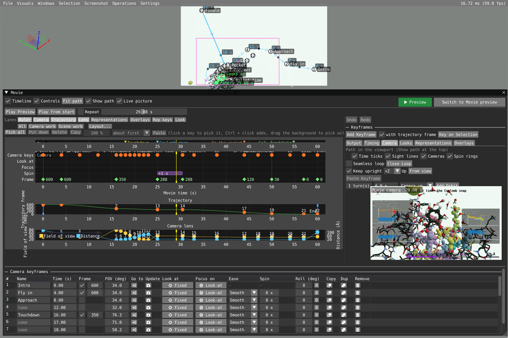

*Scene view: the camera path is in the viewport, the movie camera is in the live picture, and the keyframe table spans the bottom of the editor.*

**Undo** and **Redo** cover everything on the movie: camera keys and their targets, look and representation keys, overlays, the length and the trajectory timing.

### Scene view and Movie preview

The large button at the top right, or **Tab**, switches the viewport between two views; hold Tab to peek at the other one and let go to come back. Neither changes the keys, the playback or the recording, and the switch is disabled while recording.

| | **Scene view** | **Movie preview** |
|---|---|---|
| Camera | Your own editor camera | The movie camera |
| Shows | The recording frame (outside dimmed), the camera path and key handles | The recording frame (outside dimmed), the overlays, and the path only if **Show path** is ticked in this mode |
| Scrubbing and playing | The green movie camera moves along the path; the trajectory plays; your view stays | The viewport is the movie camera, following the keys: a camera turning around the system looks like the system turning |

Each mode remembers its own view. The first time you enter Scene view it frames the whole camera path, seen from where you were looking; **Fit path** does that again. Both modes show the same recording frame, the same size and in the same place: in the part of the viewport the Movie window leaves free (beside, above or below it), with the movie camera's view centred in it as in the recording. Move the window and the frame moves along; when the window floats in the middle, or outside the main window, the frame is centred in the whole viewport. What is in the frame is what a key added from the view records, so keys are aimed the same way in both modes. The view turns around the middle of the frame, and in Scene view the mouse wheel zooms towards the point under the mouse.

**Show path** defaults to **on in Scene view** and **off in Movie preview**. The switches are independent: changing one does not change the other. Both choices are saved with the workspace; workspaces without saved path settings use these defaults. The bundled examples use the same defaults. Path overlays are never included in recorded frames.

**Live picture** (Scene view) shows a small live picture of the movie camera, with overlays, at the lower right of the upper panels, so you can drag the path in the viewport and watch the shot at the same time. Right-click it for its size (**Small** to **Extra large**, limited to about 65 % of the upper area's height) or to hide it. It costs one extra render when the picture changes (at most about 20 times a second), so switch it off on very large systems. It has no temporal anti-aliasing or sharpening, and no property visualization.

### Preview: watch the movie

The green **Preview** button plays the movie in the viewport as it will be recorded, from the beginning, with every window, the menu and the camera path hidden and black outside the frame. A bar at the bottom has play/pause, back to the start, the time slider (scrubbing pauses, release resumes), **Repeat** and **Exit preview**; it hides while the mouse is still and the movie plays. **Space** plays and pauses, **Esc** leaves. Leaving goes back to the view you came from. It cannot be entered while recording.

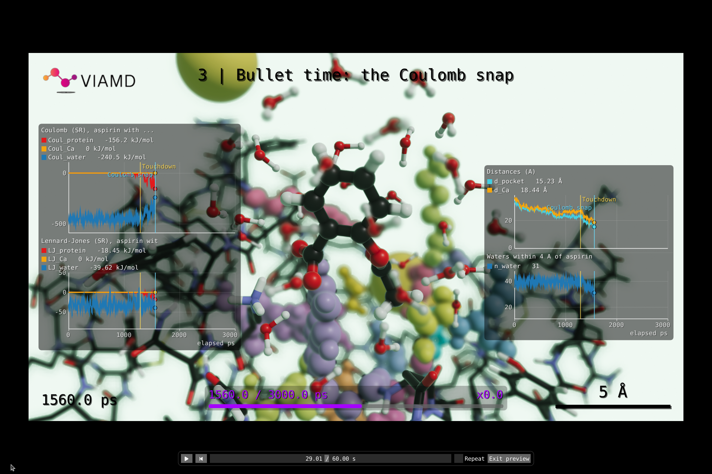

*Paused at about 29 s: trajectory frame 288 is held while the camera orbits aspirin. The aperture is 2 % of view height; energy plots, distances, water count, markers and the grey-backed time bar are drawn into the movie. The bottom playback controls belong to Preview, not the recording.*

Whenever the Movie window is open, **Space** plays and pauses the movie, not the trajectory. Opening the Movie window stops the trajectory if it was playing; closing it stops the movie.

## Shortcuts

None of these act while typing in a text field, and the editing ones are disabled while recording and in fullscreen Preview (except where noted).

| Key | Where | What it does |
|---|---|---|
| **K** | Viewport | Adds a camera key at the preview time with what the frame shows |
| **Shift+K** | Movie window or viewport, also in Preview | Adds a camera key, whichever has keyboard focus |
| **Tab** (hold to peek) | Movie window or viewport | Switches Scene view / Movie preview |
| **Space** | Movie window open, or Preview | Plays / pauses the movie |
| **Esc** | Preview / recording / a drag / a pick | Leaves Preview, stops recording, cancels a drag in the viewport, puts down picked items |
| **Ctrl+Z** | Movie window or viewport | Undoes a movie edit |
| **Ctrl+Y**, **Ctrl+Shift+Z** | Movie window or viewport | Redoes it |
| **Ctrl+C** / **Ctrl+V** | Over the lanes | Copies / pastes the picked keys, the first at the preview time |
| **Ctrl+C** / **Ctrl+V** | Elsewhere | Copies the camera key at the preview time / pastes it there |
| **Ctrl+A** | Over the lanes | Picks all camera keys and the shown look and representation keys |
| **Delete** | Over the lanes | Removes picked keys and blocks |
| **Left / Right** | Over the lanes | Moves picked keys one frame (Shift one second, Ctrl ten frames) |
| **Up / Down** | Over the lanes | Changes the value of the lane last used (Shift ten steps) |
| **Ctrl + wheel** | Over the lanes | Zooms time |
| **Shift + wheel**, middle mouse | Over the lanes | Pans time |
| **Ctrl + click** | On the camera path | Adds a key at that time without moving the camera |
| **Ctrl + drag** | A key handle in the viewport | Moves eye and aim together |
| **Double-click** | Viewport | Aims at the clicked point, eye fixed |
| **Double-click** | Camera lane | Adds a key on the path at that time |

## Quick start

1. Load a trajectory and open **Windows > Movie**.
2. **Output:** click **Select Output Folder...** and pick a format.
3. **Timing > Movie length (s)**: 60 s for a new movie; type another and press Enter. At first the trajectory fills the movie.
4. Set the preview time to 0, set up the view, press **K** (or **Add Keyframe**).
5. Move the preview time, set up another view, press **K** again. Repeat.
6. Press **Play Preview**. Switch to **Movie preview** to see the frame and overlays, or press the green **Preview** to watch it without the windows.
7. **Start Recording** (bottom of **Output**). Esc or **Stop Recording** stops early.

When the recording ends, your own view, the animation playback and the screenshot settings are restored.

## The timeline

The lanes share the time axis; the yellow line is the playhead. Above them, **Lanes** is a row of toggles, one per lane (lit when shown): **Ruler**, **Camera**, **Trajectory**, **Lens**, **Representations**, **Overlays**, **Rep keys** and **Look**, in the order the lanes are drawn. When **Rep keys** or **Look** is on, a second row picks what they show. Numbers on the lanes' axes and in the mouse readout have at most two decimals.

The presets on the line below set the lanes for a kind of work:

| Preset | Lanes |
|---|---|
| **Camera work** | Ruler, Camera, Trajectory, Lens |
| **Scene work** | Ruler, Trajectory, Representations, Overlays, Look (on **Depth of field blur**) |
| **All** | Ruler, Camera, Trajectory, Lens, Representations, Look |

A new movie uses **All**, **Fit to window** and **Depth of field blur** in the Look lane; a workspace keeps its own layout. **Layout...** has the lane height, **Fit to window**, **Snap to frames**, **Show whole movie** and the representations lane's **Lines** and **Block height**.

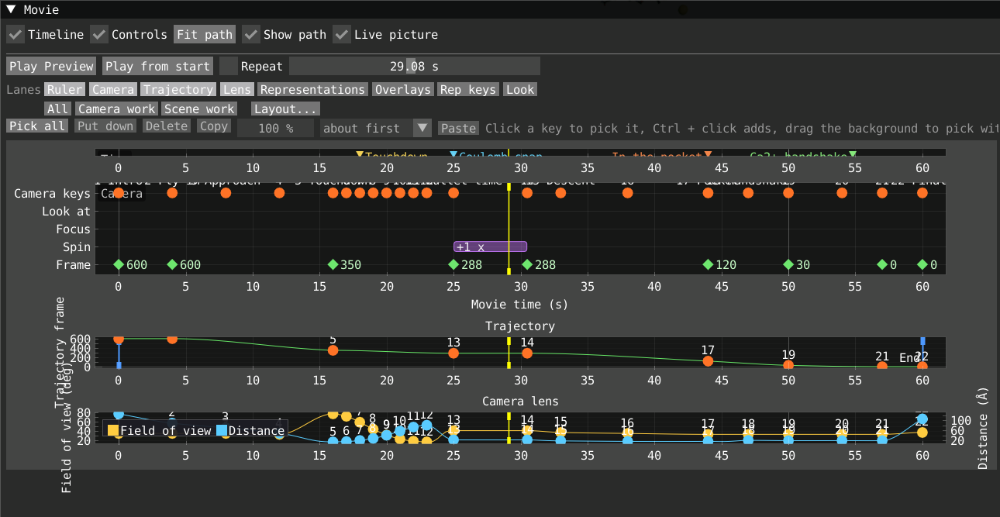

*Camera work: orange camera keys, green frame pins, and the lens curves (yellow field of view, blue distance). The pinned frame stays at 288 through the bullet-time interval.*

### Lanes

- **Ruler:** the time axis with a tick per frame once frames are a few pixels apart, the movie's markers as yellow triangles (click to go there), and the preview time. Click or drag in it to move the preview time. Every lane has its name in its top left corner.
- **Trajectory:** the frame shown at each moment. Drag the blue **Start** and **End** lines. Orange dots are keys with a pinned frame: drag sideways for time, up or down for frame.
- **Camera lane:** the camera on one lane. Before the first key and after the last one the lane is hatched grey: the camera holds still there. The first row has keys as orange dots with number and name (yellow at the preview time). Drag sideways to change when, click to go there, right-click for **Go to** and **Remove** (and the name), double-click an empty spot to add a key there on the path, without moving the camera. Row **Look at**: a blue band over keys that look at atoms ("3 atoms", "atom 12"). Row **Focus**: a magenta band from each key that tracks a focus target to the next key, its transition darker, with what is sharp and the blur. Row **Spin**: a purple band over stretches with extra turns (`+2 x`). Row **Frame**: a green mark, with the frame number, at each key that pins a frame. A key added by double-click looks at the atoms its two neighbours look at; a spin's turns stay with the part ending at the later key.
- **Lens:** field of view (left axis, degrees, 1 to 170) and camera distance (right axis) on one plot, with a legend. Drag dots sideways for time and up or down for value; each dot belongs to its curve's axis (distance moves the camera along its line of sight).
- **Look parameter lane:** the parameter chosen at the top. Double-click adds a key, drag changes it, right-click removes.
- **Representation lane:** the property chosen with the two lists next to it. The line is the value, dots are keys; same editing. For **Visible**, double-click turns it around at that time; the first one on a representation without keys also keys its present state at 0 so it holds until then.
- **Representation overview:** see [above](#the-overview-lane).
- **Overlay lane:** overlays as bars (one row and color per kind), markers as small yellow triangles. Drag a bar to move it, an end to change when it starts or stops. Moving a whole bar moves the in and out times of its subplots; small ticks in a bar show where subplots come in. Hover for name and times.

### Picking and moving things together

Camera keys, trajectory, lens (distance and FOV), look-parameter and representation-lane keys, overlay bars and overview blocks can be picked and moved as a group.

- **Pick:** click an item (a white ring shows it). **Ctrl + click** adds or removes. **Drag on a lane's empty background** draws a box (Ctrl or Shift: adds; in the camera lane it picks by time only). A click on the background puts all down. **Pick all** (Ctrl + A) picks the camera keys and the shown look and representation keys. A camera key is one key in every lane it appears in. Clicking a key's handle in the viewport picks it too.
- **Move:** drag a picked item and all move by the same time and, in lanes with a value, by the same amount (frame, distance, FOV, parameter value, property value; colors and **Visible** move in time only). A tooltip shows how far (`5 keys: +1.20 s  +0.5`). The group stays inside the movie, keeping the spacing, and lands on frames with **Snap to frames**. Dragging an unpicked key picks it alone. One drag is one undo step. A key landing on another in the same lane replaces it on release.
- **Bars and blocks:** dragging a picked bar or block by its middle moves everything picked by the same time, and takes along what is timed inside a bar. A block stops at other blocks of its representation. Dragging an end still changes only that end. **Delete** removes picked blocks and keys (never an overlay). Unkeyed blocks cannot be picked.
- **Stretch:** the percentage box next to **Copy** stretches the time between picked items about the first one or the preview time (the list beside it). 100 % is unchanged. It stops where something would leave the movie. One undo step.
- **Inspector:** a line above the lanes says how many of each kind are picked. **first at** moves all so the first is at the typed time. The ease list sets how the movie gets to every picked key (**(mixed)** when they differ). One picked camera key can be renamed there.
- **Keyboard:** see [Shortcuts](#shortcuts). **Pick all**, **Put down**, **Delete**, **Copy** and **Paste** above the lanes do the same.

### Zoom, panning and layout

- Ctrl + wheel zooms time; **Show whole movie** resets. Because dragging on the background picks, pan with the **middle mouse button**, **Shift + wheel** or sideways scrolling.
- **Lane height** (60 to 400 px) times each lane's proportion (drag between lanes to change it). The window scrolls with the wheel when lanes do not fit; the overview, overlay and camera lanes grow to fit their rows without making others taller. **Fit to window** shares the window height among the lanes instead, and then the wheel zooms.
- The **Lanes** toggles hide or show a lane; the settings below are in **Layout...**.
- **Snap to frames** (default on): dragged keys, the playhead, the trajectory start and end, and keys added at the preview time land on a frame at the **Output FPS**.

## Output

| Setting | What it does |
|---|---|
| **Select Output Folder...** | Where the movie is written. Recording is disabled until one is chosen. |
| **Filename Prefix** | `prefix.mp4`, or `prefix_00000.png`, `prefix_00001.png`, ... |
| **Format** | **MP4 H.264**, **MP4 H.265** and **WebM VP9** pipe frames straight into ffmpeg (it needs libx264, libx265 or libvpx-vp9 respectively); no image files are written. H.265 files are usually noticeably smaller and are tagged so QuickTime plays them. **PNG sequence** writes one image per frame. |
| **Quality (CRF)** | Video only. Lower is better and larger. H.264: 18 is close to lossless, 23 the default. H.265: 4 to 6 higher looks the same (default 28). VP9: 15 to 35 is usual (default 32, up to 63). |
| **ffmpeg** | Video only. The executable; a bare name is looked up on the PATH. |
| **Copy ffmpeg command** | PNG only. Copies a command that encodes the sequence into an MP4. |
| **Resolution** | **Window** (its size when recording starts), Full HD, Quad HD, 4K, 8K, or **Custom** (**Res X**, **Res Y**). |
| **Output FPS** | Frames per second. Both endpoints are included: `floor(length × FPS + 1e-6) + 1` frames for the whole movie (60 s at 24 FPS gives 1441). |
| **Scale** | 100, 75, 50 or 25 % of the size above. Small renders much faster: use it to check a movie first. |
| **Samples per frame** | With temporal anti-aliasing: how many rendered images are averaged per frame. 0 uses the jitter sequence length. Fewer is faster, more smoother. |
| **Render only a range** | Renders the frames between two times (**Range (s)**), e.g. to redo a part. A PNG sequence keeps the frame numbers it has in the whole movie, so the files can replace the old ones. **Start at preview time** and **End at preview time** take the times from the playhead. |
| **Save a workspace copy with the movie** | Writes `prefix.via` next to the movie with the camera path, looks, overlays and settings. Opening it and recording again gives the same movie. |

While recording, **Pause** and **Resume** stop and carry on. The progress bar shows frames done and, after a few frames, the time left. The **Representations** window is locked while recording.

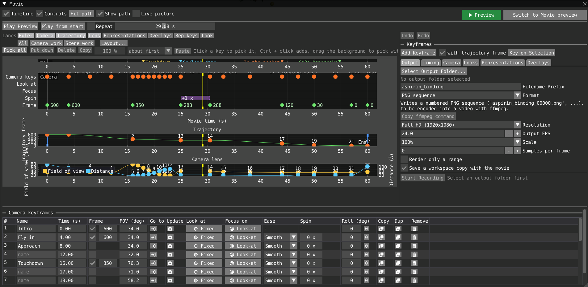

*Output: choose a folder, format and resolution here. The aspirin example uses Full HD, 24 FPS and a PNG sequence; recording remains disabled until an output folder is selected.*

## Timing

- **Trajectory Frames:** the first and last frame used. Start after end plays backwards.
- **Movie length (s):** applied on Enter. **Everything on the timeline scales with it** (camera keys, look and representation keys, overlays and fades, the trajectory start and end), so the movie keeps its shape and only gets faster or slower. Frame numbers and spin counts are unchanged.
- **Trajectory plays (s):** the movie times at which the trajectory is at its first and last frame. Before the start it is held on the first frame (for a fly-over first), after the end on the last. These are the blue **Start** and **End** lines in the timeline, where they can also be dragged.
- A grey line shows the average speed in frames per second and relative to the Animation window. **Match Animation speed** sets the movie length so the trajectory plays at that speed.

To vary the speed, pin frames on camera keyframes (**Frame** column below): between two pins the trajectory plays at whatever speed gets from one to the other. A pin before Start or after End moves that line out to it.

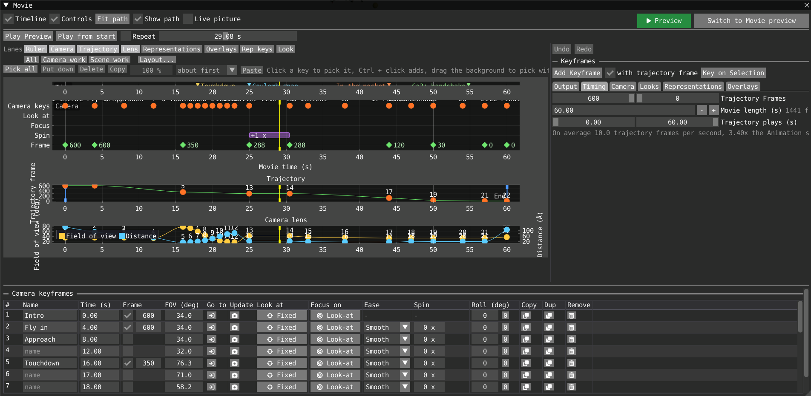

*Timing: this example plays frames 600 to 0 over 60 s, with camera-key pins changing the pace and freezing the trajectory during the orbit. Movie length is set here, not in Output.*

## Camera

A keyframe is a camera (eye position, look-at point, distance, field of view) at a time. It also says what the camera **looks at** and what is **in focus**, each independently of the rest. Between keys the camera moves smoothly; before the first and after the last it holds still.

In Movie preview, previewing and recording always follow the keys; in Scene view your own camera stays and the green movie camera moves along the path.

### Adding keys

- **Add Keyframe** (**K**, or **Shift+K** from anywhere in the editor): a key with what the frame shows at the preview time. When there is a key at the preview time already, the new one goes **2 s later** and the preview time moves there (refused past the movie end). **with trajectory frame** (checked by default) also pins the frame shown now.
- **Add a key on the path** (right-click **Add Keyframe**, double-click the Camera lane, or **Ctrl + click** on the path in the viewport): a key where the path already has the camera, so the path keeps its shape.
- **Key on Selection:** a key at the preview time framing the selected atoms from the current direction, and moves the viewport there. Molecules split by the periodic cell are framed as one.

### Camera tab

- **Add Orbit:** fields for turns, duration and axis (**Camera up**, **World X/Y/Z**) set a key at the preview time and another one *duration* later after the camera has gone round the look-at point. Refused if it would run past the movie end.
- **Seamless loop** and **Close Loop:** make the path cyclic so a repeating movie does not jump. **Close Loop** adds a final key in the first key's pose and turns the loop on.
- **Keep upright** (on for new movies), **Up**, **From view:** the camera stays level with the chosen world axis up on screen, so loops and spins cannot leave it tilted. **From view** picks the axis closest to the view's up. Keys then give only where the camera looks from and at; the tilt is the key's **Roll (deg)** (positive leans left, 0 levels), eased smoothly. A key made from the view takes the view's own tilt as its Roll, so it plays back as it was seen; set Roll to 0 to level it. A spin around **Camera up** turns around the up axis. Off, the keys' own tilts are used; the **Roll** column then shows each tilt with a **Level** button.
- **Paste Keyframe:** puts in the key copied from the table (see below).
- Path drawing options: time ticks, sight lines, cameras, spin rings (see [The camera path in the viewport](#the-camera-path-in-the-viewport)).

### The keyframe table

The table fills the bottom of the Movie window. Columns resize by dragging their borders; the table scrolls sideways when wider than the window.

| Column | Meaning |
|---|---|
| **#** | The key's number. Drag it onto another row to move the key's pose there; times stay. |
| **Name** | Up to 23 characters ("intro", "close-up"), shown in the camera lane and saved. |
| **Time (s)** | When. The list re-sorts when you finish editing. |
| **Frame** | Tick to pin a trajectory frame to the key, then drag the number. A frame lower than the previous pin plays backwards. |
| **FOV (deg)** | Field of view. Narrow it to zoom without moving. |
| **Go to** | Moves the viewport to the key. Clicking a key's orange marker in the **Timelines** window does the same. |
| **Update** | Moves the key's eye to the viewport camera, still looking at the same point; also takes the FOV and, if pinned, the frame. |
| **Look at** | **Fixed point** or **Track selection**. See [Look at and focus on](#look-at-and-focus-on). |
| **Focus on** | **Look-at** or **Track selection**. See [Look at and focus on](#look-at-and-focus-on). |
| **Ease** | How the movie gets *to* this key: **Smooth** passes without stopping, **Ease in/out** slows at both ends, **Linear** is constant speed, **Hold** stays then jumps. |
| **Spin** | Extra whole turns around the look-at point on the way to this key. **...** opens the axis and **Constant speed**. |
| **Roll (deg)** | See **Keep upright**. |
| **Copy** | Remembers the key. **Paste Keyframe** puts it in at the preview time, replacing one that is there. |
| **Dup** | Copies the key to one second later. |
| **Remove** | Deletes the key. |

To edit a key: **Go to** it, move around, **Update**, then choose its **Look at** and **Focus on**. A line below the table shows the eye, look-at point and distance at the preview time (and the focus distance when there is blur).

### Look at and focus on

Each key sets, independently of its eye position:

- **Look at**, what the camera is aimed at:
  - **Fixed point** (default): where the key's pose aims. Drag or type its coordinates, or **Use view aim** to take the viewport's.
  - **Track selection**: the centre of atoms, followed through the trajectory. Use a selection typed in the filter language (`protein`, `resname("AIN")`, `resid(12)`, a named selection ...; Enter applies, red when it is invalid or empty), the current selection, or one atom picked in the viewport. The centre is mass-weighted and made whole across periodic boundaries, and the expression is evaluated again for the system and frame shown.
  - Switching a tracked key back to **Fixed point** freezes the centre where it is now.
- **Focus on**, what is sharp:
  - **Look-at** (default): whatever this key looks at, fixed or tracked.
  - **Track selection**: other atoms, chosen as above, with **Transition** (seconds from the key's time) and **Ease**. A transition finishes no later than the next camera key.
  - A key on **Look-at** brings the focus back to its look-at; it does not carry an earlier key's target forward. To keep focus on the same atoms over several keys, set it on each.

The aim moves from one key's look-at to the next with the key's easing, so the camera can look at one molecule and then turn to another while the eye travels its own way. Choosing **Track selection** uses the selected atoms, or starts picking in the viewport when nothing is selected (Esc cancels). Targets are saved with the key and are copied, pasted, moved, stretched and deleted with it; undo covers them, and changing the movie length scales their transitions. Atoms missing from the current system are reported once and the key's saved point is used.

**How blurred the rest is** is not part of the key: it is the look parameter **Depth of field blur** (Looks tab and Look lane). Key it, ease it and smooth it like any other look parameter; **Key the blur here** in the Focus on popup is a shortcut. Zero makes everything sharp whatever the focus target. Opening the Movie window starts the movie's unkeyed blur at zero; keyed blur still applies at the preview time and during playback.

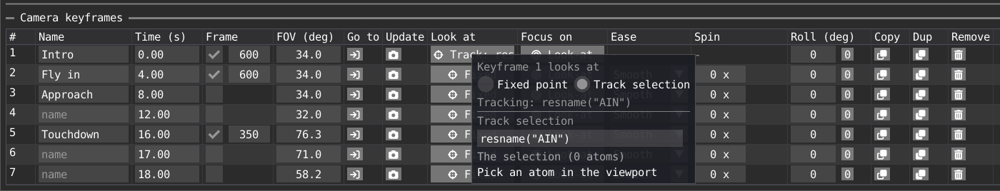

*Look at: Track selection `resname("AIN")` aims at aspirin. Fixed point keeps an explicit aim instead.*

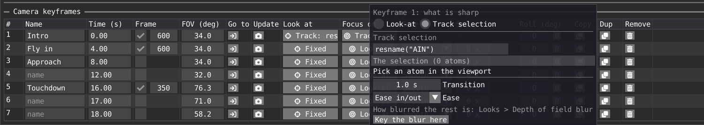

*Focus on: keep Look-at, or track a different selection independently. This editing demonstration tracks aspirin with a 1 s transition; Key the blur here adds a separate look-parameter key.*

**Examples.**
- *Follow a general direction, keep a moving molecule sharp:* keys with **Look at: Fixed point** along the path, and on the first one **Focus on: Track selection** `resname("AIN")`; repeat it on later keys that should keep it. Key **Depth of field blur** above 0.
- *Rack focus on a still shot:* two keys with the same pose a few seconds apart; the second sets **Focus on: Track selection** to the other object with a **Transition** of 1 to 2 s.
- *Blur only for a while:* key **Depth of field blur** at 0, then up, then back to 0.

### Movie focus and the ordinary viewport

Outside the movie, **Visuals > Depth of Field** always focuses on the camera's look-at point (**Auto**): double-clicking an object aims there and so focuses there. Its **Blur Strength** is saved with the workspace.

While the Movie window is open, in Preview and while recording, the movie owns the focus: Movie preview, the live picture, Preview and the recording follow the keys, and the Depth of Field controls show **Focus: driven by movie** and are read-only. Scene view keeps its own focus depth, taken when the movie opens, so changing a key's target does not refocus your editor camera. Closing the Movie window gives back the viewport's own focus and blur.

**Blur Strength** and the movie's **Depth of field blur** use the same units: the blur of distant objects as a percentage of the view height, independent of zoom.

### The camera path in the viewport

**Show path** draws the paths over the viewport while the editor is open (never in recorded frames):

- **Camera** (blue), **look-at** (yellow) and **focus** (magenta, where a key tracks a focus target). Each is brighter ahead of the preview time than behind.
- **Time ticks:** dots at round times (the step adapts to the movie length) with the time written at some, and chevrons for the direction. Close dots mean slow, far apart fast, so the easing can be read off. Yellow diamonds mark the same times on the look-at path.
- **Sight lines:** a thin line from the eye to its target at each tick. **Cameras:** a camera drawn at each key, orange at the preview time. **Spin rings:** the circle a spin goes round, with arrows and the turn count.
- **Key handles:** a round one on the eye (with the key's number and name) and a ring with a cross on what it looks at (and on the focus target), joined by a line. White for a fixed point, blue for atoms, orange at the preview time. Hovering one highlights the key in the camera lane and vice versa. **Click** goes to the key and picks it. **Drag** a handle to move that part of the key only (a tracked look-at or focus becomes a fixed point); **Ctrl** moves the eye and the aim together. The handle moves in the plane facing you; Esc cancels; a drag is one undo step.
- **Ctrl + click on the path** adds a key at that time without moving the camera.
- The **green camera** is the camera at the preview time: a green dot on the eye, a green ring (**looks at**), and a thick arrow between them. Orbit the scene to see the path from other sides.
- With keys that look at atoms, the look-at path follows them through the trajectory. It is computed a few points at a time, so it grows for a moment; the old path stays until the new one is ready.

### A small FOV and focus tutorial

Open [fov_and_focus.via](examples/fov_and_focus.via) and press the green **Preview** button. Its companion [fov_and_focus.xyz](examples/fov_and_focus.xyz) is a tiny synthetic trajectory in the repository; keep the two files together.

- **0-18 s, field of view:** the atoms and the camera stay fixed; blur is off. FOV goes from **45 to 20 degrees** (objects grow), then to **70 degrees** (objects shrink), then back to 45. This is lens zoom, not camera travel: the Camera table shows the FOV changing while the distance stays at 32 A.
- **18-32 s, depth of field:** FOV, position and aim stay fixed. Blur turns on over two seconds and focus tracks the centre carbon. The red foreground oxygens become sharp when it reaches their depth (22.5 s), then the blue background nitrogens (31.5 s).
- **32-34 s:** focus racks from the moving carbon to a fixed point on the red oxygen over one second.
- **34-36 s:** blur fades to zero over one second; everything is sharp again.

Open **Focus on** of the keys at 18, 32 and 34 s: the first tracks the carbon, the second holds the oxygen's fixed position (an older kind of focus key, shown read-only), the third is back on **Look-at**. The blur, 0 to 3.5 % and back, is keys of **Depth of field blur** in the Looks tab.

**In short:** FOV changes how much you see and how big things look; depth of field changes what is sharp. A narrow FOV does not blur by itself, and more blur does not zoom.

## Looks

Background color and intensity, ambient occlusion, exposure, depth-of-field blur and the near and far clipping planes can change during the movie.

1. Pick the parameter in the list.
2. Move to the preview time and press **Key Now**.
3. Edit the key's **Value** and **Ease** in the table, or drag it in the Look lane. For settings that remain editable in **Visuals**, you can set their value there before keying it.

For **Depth of field blur**, use the movie table or lane: the ordinary viewport's Depth of Field controls are read-only while the movie owns focus. Values are aperture in percent of view height, not the scale-dependent blur units of old workspaces.

The table lists keys with time, value, ease and **Remove**. With **Animate parameters** on, keys are followed when scrubbing, previewing and recording; closing the editor restores the ordinary viewport's values.

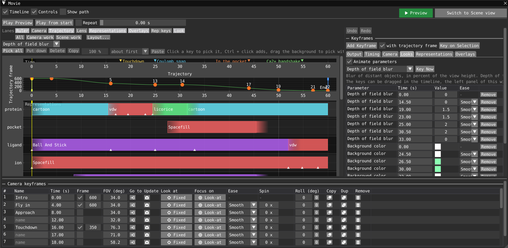

*The shipped binding example starts sharp, rises to 1.5 % for the dolly zoom and 2 % for bullet time, then returns to 0 at 33 s. These are active Depth of field blur keys, not legacy unknown rows.*

## Representations

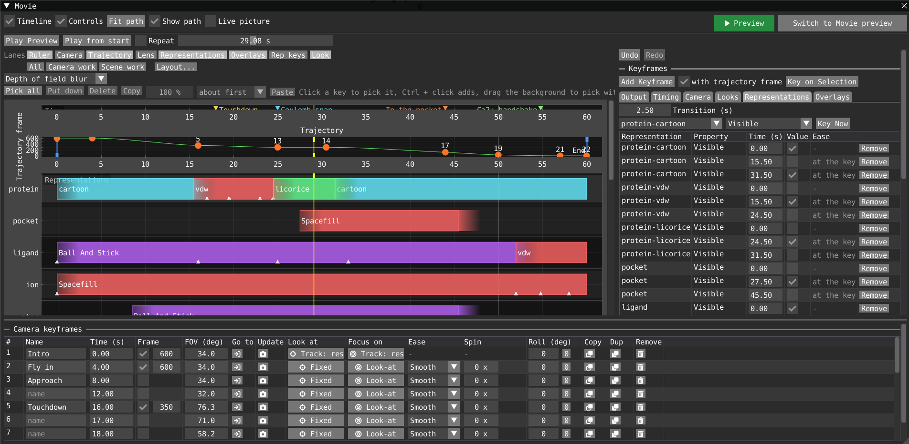

*Scene work: the overview shows the cartoon, surface and licorice hand-overs, with visibility keys and a 2.5 s transition in the inspector. The bottom camera table remains available.*

### Keying a property

Pick a representation and a property, set it up in the **Representations** window as it should be at the preview time, and **Key Now**.

- **Visible:** shown or hidden. Solid representations cannot fade, so they grow in or shrink away instead: at a key they start going to the new state over **Transition (s)** (default 2, set above the table; 0 is instant), their sizes scaled during that time and hidden at zero. Key it once to appear and once to go. Keys closer than the transition turn around from where it was. Electronic-structure and dipole representations cannot be scaled: they are shown fully until the transition ends and then vanish.
- **Scales** (**Radius scale**, **Ball scale**, **Bond scale**, **Width**, **Coil**, ... whatever the type has), **Tint scale** and **Saturation** move smoothly with the usual **Ease**.
- **Base color** (visible where color mapping is Uniform) and **Tint color** (visible where **Tint scale** > 0), edited in the table; in the lane their keys are squares in their color.

A key belongs to a representation by an id that survives moving, duplicating or removing representations and is saved in the workspace; removing a representation removes its keys. **Animate parameters** switches these on with the look keys. Tint and saturation recolor the atoms every frame, which is slow for very large systems; scales and visibility are cheap.

### The overview lane

The **Representations** lane (the representation overview) has one band per system (protein, ligand, water, ...). A colored block is a stretch where one representation is shown; colors identify types. A block that starts where another ends stays on the same line and the two cross-fade; only representations shown at the same time stack. **Layout... > Lines** sets how a system is drawn: **Compact** (default), one line per system with overlapping blocks sharing its height; **Stacked**, another full line only where blocks overlap; **Separate**, a line for each representation, grouped by system. Stacked and Separate make the lane grow unless **Fit to window** is on. **Block height** (×0.5 to ×2.5) makes the blocks taller or flatter, and the lane with them; it has no effect with **Fit to window**. A representation enabled without keys has a block over the whole movie.

- **Drag** a bar to move it, or an end to change when it starts or stops. Times land on frames with **Snap to frames**; a bar stays between its neighbours.
- **Double-click** empty space in a system row to add one of its existing representations (a tenth of the movie long, up to that representation's next block); it may overlap others.
- **Right-click** a block: switch that interval to another existing representation of the system, or **Remove block**. Switching keeps other systems and property keys; overlapping target blocks merge. Removing the last block leaves the representation hidden.
- Clicking a block selects its representation (and **Visible**) for the **Representation lane**.

**Systems.** Representations named alike up to the first hyphen share a row: `protein-cartoon`, `protein-cpk`, `protein-vdw` belong to `protein`. A plain `protein` joins the same row (its block is labelled with the type). Other names without a hyphen get a row of their own. Rename in the Representations window to group. Switching a block chooses an existing representation; it does not make a new selection.

**Swap.** **Swap with the next of its group** hands over at the preview time from the selected representation to the next one of its group with the transition, e.g. `protein-cartoon` shrinks away while `protein-cpk` grows in. A representation without keys is taken to have been shown (the one that goes) or hidden (the one that comes) until then.

## Overlays

Overlays are drawn in recorded frames and in **Movie preview**. In the **Overlays** tab use **Add overlay...** and pick a type. Select one in the list to edit it: **Content** (type-specific), **Timing** (range and fades), **Appearance** (position, size, colors). Clicking an overlay bar in the timeline selects it too. A new movie starts with the VIAMD logo in the top left for the whole movie; **Remove** it if unwanted (the workspace remembers).

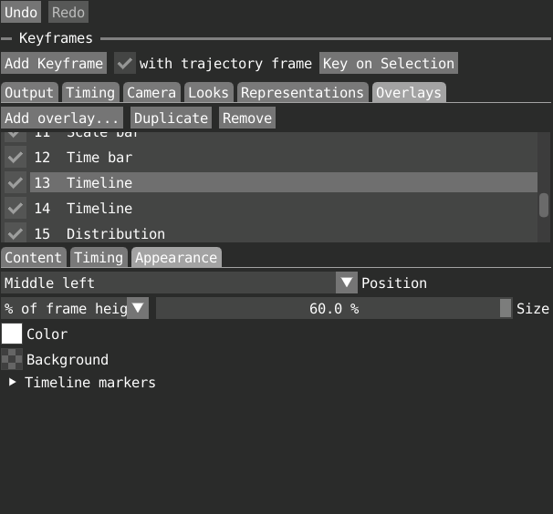

*Content: one timeline overlay contains the Coulomb and Lennard-Jones subplots, sharing an elapsed-time axis.*

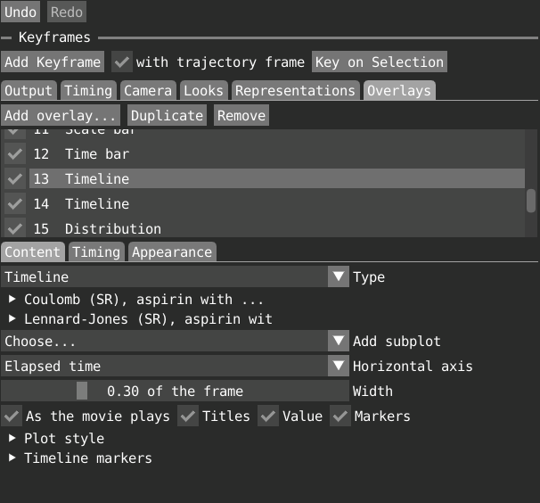

*Appearance: the energy overlay is anchored Middle left and sized to 60 % of frame height. Timing controls its range and fades separately.*

### Common to all overlays

- On/off box, **Type**, **Duplicate** (a copy right below: handy to show something else at another time or place) and **Remove**.
- **Shown (s)**, with **Start at preview time**, **End at preview time**, **Fade in (s)** and **Fade out (s)**.
- **Position:** one of nine anchors.
- **Size:** a part of the frame height, or in points (a point is a pixel of a 1080-high frame, scaled with the frame so it looks the same at any resolution). Text: its height; logo and image: their height; timeline and distribution: the whole stack.
- **Color** and **Background** plate (none while its opacity is 0).
- Overlays shown at the same time never overlap. Those in the top and bottom rows keep their place before those in the middle row, and the centre column before the sides. One that would hit a placed one moves past it: up from the bottom row, down from the top row, the shorter way in the middle row. So a bottom-left time bar sits above a wide bottom-centre timeline, and a tall middle-right timeline moves down a little under a top-right distribution. An overlay is never pushed out of the frame; when there is no room it stays where it is. Overlays shown at different times do not push each other, and an overlay keeps the same place for its whole range.

### Kinds

- **Text:** the words you type.
- **Time stamp:** time gone since the movie started, in the timeline's unit (**N frames** if the trajectory has no times). It starts at 0 and only grows, whichever way the trajectory plays, and reads the same whenever it is shown (one appearing at 40 s reads the time since the start). A hold does not advance it. Same quantity as the time bar's **Time that has gone**.
- **Scale bar:** a bar of a known structure length, as long on the frame as it is at the distance the camera looks at, so it follows the zoom. **Length** 0 picks 1, 2 or 5 times a power of ten.
- **Logo:** the VIAMD icon on transparency. Its light grey is made black for contrast on a light picture; on a dark one give it a light **Background**. **Color** multiplies the picture (white keeps it).
- **Image:** a png or jpg (a group logo, a figure), shown like the logo with transparency kept. The path is saved relative to the workspace, so keep the file with it. **Reload** rereads it; the box turns red when it cannot be read.
- **Time bar:** how far the trajectory has gone. It fills left to right whichever way the trajectory plays, fast where it plays fast, slowly where slowed and not at all in a hold, so it shows the pace. **Width** is a part of the frame width, **Size** the text height. **Time that has gone** writes the time covered over the whole; **Speed** the multiple of the Animation window's speed. The unfilled track is neutral grey; new time bars have a translucent grey plate (**Appearance > Background**); old workspaces keep their saved plate.
- **Property:** the visualization of a script property (atoms, geometry and the labels hovering its plot shows) while the overlay is shown, with fades, in preview and in the recording. Type the identifier or pick it from the script. The script must have evaluated the property.
- **Timeline** and **Distribution:** subplots of the **Timelines** and **Distributions** windows drawn into the movie (see next section). A timeline is wide and low at the bottom center, a distribution narrow and tall at the middle right; both can be moved and resized.

### Timeline and distribution overlays

*Which subplots.* A new overlay holds the subplots of its window that have series. **Add subplot** adds one, **Up** moves it up, **Remove** takes it out; several are stacked, each with its own scale and legend. What is drawn is what the subplot shows in its window, in its colors, at most six series per subplot and the first member of a population. A subplot is found by an identity of its own, not its position, so adding or naming subplots does not change what an overlay draws. Name them in the **Subplots** menu (**Names**) of their window. A subplot that is gone or empty is reported in the overlay and not drawn.

*As the movie plays.* Plots grow with the movie (**As the movie plays**; off shows the whole plot). A line and a dot mark the current frame; **Value** writes the value there, in the plot's unit, in the legend.

- **Timeline.** The horizontal axis is by default **Elapsed time**: trajectory time covered by the movie, as in the time bar. The curve always grows to the right, also where the movie plays backward (the series is read backward; at a turn the curve goes on rightward; a hold adds nothing). **Trajectory time** is the trajectory's own time, turned around when played backward. The axis spans the whole movie, and the curve is drawn from the start up to now, so a timeline that appears late already shows what happened before, with the same labels as ever. The overlay's own range only decides when it is visible. Timelines stacked above each other share the axis, labelled under the last.
- **Distribution.** Counted over the frames played since the movie started, so its bars grow to the shape of the whole, also when it appears late. A distribution of a script that is not over frames (an RDF) is drawn as it is.
- **Number of bins** (2 to 4096) applies to all subplots of a distribution overlay without changing the Distributions window; new overlays use 128. **Use source bin counts** keeps each series' own setting (the default for older workspaces). Script distributions can only be coarsened to a divisor of the resolution they were evaluated at.

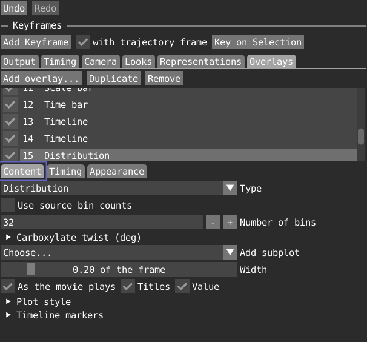

*The binding example chooses 32 bins for the carboxylate torsion. This is an example-specific setting; a newly added distribution overlay starts at 128 bins.*

*Subplots that come in at different times.* Each subplot has **in at** and **out at** (movie seconds within the overlay's range; **stays to the end** when equal), and **In at preview time**. A subplot added while the preview is later in the overlay comes in there. It fades with the overlay's fades. A property that comes in later is drawn from the start of the movie as if it had always been there: a curve that comes in at 30 s appears with what it did up to then and keeps growing; a distribution has counted every frame so far. The plate covers only the subplots that are there, so it grows when one comes in, and the place of a subplot not there yet stays free, so the others do not move. For a different place, use another overlay.

*Titles and look.* **Titles** writes a title above each subplot: the **Title** in its row, else the subplot's name, else none. **Text (points)** and **Lines (points)** set sizes in points (0 follows the height). **Colours** gives series colors of their own instead of those in the plots, and two buttons set light text on a dark plate or dark text on a light plate. **Width** is a part of the frame width.

*Markers.* Expand **Timeline markers** under the overlay inspector. **Add marker at the preview time** or **Add one at each camera key**, then set time, label and target. **All timeline subplots** puts the line and label on every timeline; choosing a subplot puts them on that subplot only, in any timeline overlay containing it. Targets use stable subplot identities, survive renaming and save/load, and a missing one is reported, not reassigned. **Markers** in an overlay hides its markers. Marker times scale with the movie length. Each marker has a color of its own: the swatch before its time picks one, right click goes back to automatic, which gives markers different colors from a palette in time order. Its line and label in the overlays and its triangle in the ruler and overlay lane have that color. Older workspaces load with automatic colors. A label starts at its marker and runs right in the first half of the plot; in the second half it ends at its marker and runs left, so labels near the end stay readable. A label that would run into one written before (on the same subplot) goes on a lower row (up to three, as room allows); if every row is taken it goes on the other side of the marker, and only if that is taken too does it overlap, where it overlaps least. Labels never run past the plot's edges. The marker labels in the editor's ruler are placed the same way, on lines above the frame numbers.

## Saving

The movie (length, trajectory timing, camera keys with their names, look-at and focus targets, look and representation keys, overlays with bin counts and markers with subplot targets, path options, timeline layout and keyframe table height) is saved in the workspace (`.via`) under `[Movie]`, with the subplot names the overlays use. Whether Scene view or Movie preview is shown, and which editor panels are visible, are not saved.

### Older workspaces

Workspaces from earlier versions load and are converted:

- Separate **Look-at** and **Focus** tracks, and keys that followed a follow target or an atom, become per-key **Look at** / **Focus on**: a camera key is added on the path where a track had a key, tracked keys look at the centre of their atoms, and focus blur becomes keys of **Depth of field blur** with the same transitions. The eye path of such a movie can differ slightly.
- Focus keys on a fixed point or at a fixed distance keep working and are shown read-only; choose **Look-at** or **Track selection** to replace them.
- A global Fixed or target focus mode becomes **Auto**, with a notification.
- Keys of the old **Focus distance**, **Occlusion radius** and depth-of-field blur parameters (from before the renderer update) are kept but inactive, with a message: their units cannot be converted. Key **Depth of field blur** again.
- Separate distance and FOV lane visibility settings become one **Lens** setting: if either old curve was enabled, both curves are shown; if both were disabled, Lens stays hidden.

## Example workspaces

[`examples/aspirin_phospholipase_movie.via`](examples/aspirin_phospholipase_movie.via) is an 80 s movie of aspirin in phospholipase, with the trajectory played backward. It has camera keys (the first look at the aspirin), keyed depth-of-field blur, representation keys, two markers ("Pocket shown", "Aspirin enters the pocket"), a logo, title, time stamp, scale bar, a time bar with a grey plate, four timeline subplots that come in at different times, a 128-bin distribution with a title, and three property visualization overlays. It opens at the saved preview time (about 48.63 s): set the scrubber to 0 and play. Aperture starts at 0, rises to 2 % at 20.9 s, decreases to 1.5 % at 30.79 s, and returns to 0 at 37.46 s.

[`examples/aspirin_binding_movie.via`](examples/aspirin_binding_movie.via) is a 60 s movie of the same data, built to show what the tools can do together. The trajectory is played in reverse, so aspirin approaches and docks. It is in five chapters:

1. **The approach** (4 to 16 s): the trajectory plays fast, the camera glides in, the waters around aspirin come in.
2. **First contact** (16 to 24 s): a **dolly zoom** at touchdown. Over 7 s the camera backs away from 14 to 80 A while the field of view narrows from 76 to 16 degrees, so aspirin keeps its size and the protein behind it seems to rise. The cartoon hands over to a spacefill surface that loses its color behind aspirin.
3. **Bullet time** (25 to 30.5 s): the trajectory is frozen at the frame with the strongest protein-aspirin Coulomb attraction (frame 288) while the camera goes once around aspirin (a spin of one turn, slightly tilted, with a tinted background and shallow depth of field). The surface changes to licorice, then the pocket residues grow in.
4. **Into the pocket** (31 to 44 s): the cartoon returns and the camera tracks aspirin down into the pocket.
5. **The calcium handshake** (47 to 57 s): in slow motion the carboxylate meets the Ca2+ ion, which swells at the strongest attraction; the waters leave and aspirin changes to spheres. The camera then pulls back for the end title.

The plots are the short-range Lennard-Jones and Coulomb terms from the `.edr` between aspirin and the protein, the Ca2+ ion and the water, and the geometry (distances to the pocket and to the ion, the number of waters around aspirin, the torsion of the carboxylate), each coming in at the time it matters, with four markers. The energies are read from the `.edr` with `attr("edr/...")` in the workspace's script.

The reasoning behind its choices (the physics of the energy terms, the placement of aspirin and of the camera, the dolly zoom, the bullet time, the representation hand-overs) is written up in [`aspirin_binding_movie_article.md`](aspirin_binding_movie_article.md). Its scientific figures describe the trajectory and camera design; current application screenshots are in this manual. The [generation and analysis tools](examples/tools/aspirin_movie/) are in the repository.

Both examples have been re-authored for the current aperture-based blur parameter; these values are artistic retunings, not numeric conversions of the old renderer's units. Camera keys, trajectory timing and representation changes are unchanged.

Both refer to `aspirin-phospholipase.gro`, `.xtc` and `.edr` in their own folder, which are not in the repository. Put your copies next to the workspace and use **File > Open Workspace**, then **Evaluate** its script in the Script Editor so the property plots and overlays have data.

## Tips

- Plan the length first, then place keys. If the pace is wrong, change **Movie length**: everything stays in proportion.
- For a fly-over before the dynamics, drag the blue **Start** line right.
- To slow an event, pin frames on two keys around it and move them further apart.
- If a loop or spin tilts the camera, tick **Keep upright** (use **From view** if up is not +Y).
- **Smooth** keys never stop the camera; use **Ease in/out** or **Hold** where it should rest.
- PNG sequences are safest for very long or large movies; encode them afterwards with **Copy ffmpeg command**.
- Check motion at **Scale** 25 % with few **Samples per frame**, then render at full size. To fix one part, use **Render only a range** with a PNG sequence and replace the files.
- Name representations after their selection (`protein-cartoon`, `protein-cpk`) so the overview keeps them together.

## Known limits

- A timeline or distribution overlay draws at most six series per subplot and the first member of a population, and a timeline overlay has one axis kind for all its subplots.
- Solid representations cannot fade; they grow in and shrink away.
- The Representations window is locked while recording.
- Tracked paths in the viewport are drawn from the current trajectory frame.
- With **Keep upright**, a spin around a horizontal axis flips over at the top and bottom (the camera cannot stay level looking along the up axis). Roll eases as a number, so 170 to -170 degrees turns the long way round.
