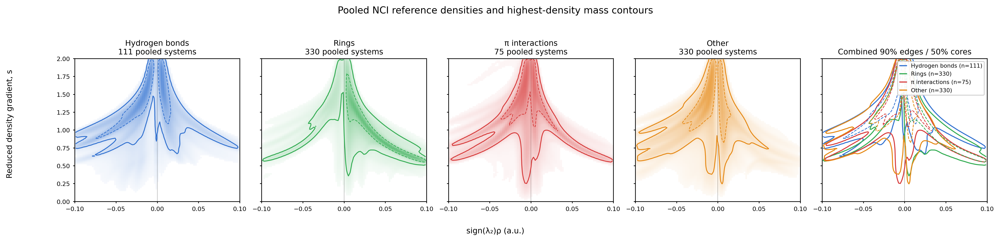

# VIAMD Topological Analysis: implementation and NCI reference maps

This note describes the current implementation in the `CP` branch, separates
standard non-covalent interaction (NCI) analysis from VIAMD's CP-local
workflows, and records the provenance and limits of the reference maps. It is
an implementation account, not a claim that the chemical labels or reference
regions are experimentally validated interaction energies.

Implementation baseline: VIAMD `34bea06e` and mdlib
`544c1b225be5eb18a332051690d4d59150b9f9ae`, 4 November 2026.
The [user guide](topological-analysis-wiki.md) is a standalone wiki-page draft
kept in this branch; it is not integrated into the published wiki.

## Contents

- [Defaults and reference domain](#at-a-glance)
- [Conventional NCI and chosen conventions](#what-nci-means-here)
- [Architecture](#application-architecture-and-separation-of-responsibilities)
- [CP search](#cp-search-in-mdlib)
- [Chemical categories and complete guide catalogue](#chemical-classification-and-the-four-reference-categories)
- [Classification rules, character and energy descriptors](#classification-rules-and-separate-local-descriptors)
- [Extraction, sampling and contours](#live-extraction-sampling-and-surface-construction)
- [Every source dataset and pooling choices](#pool-construction-and-data-provenance)
- [Interpreting scores](#reading-the-maps-and-scores)
- [Reproduction pipeline](#reproduction-from-wavefunction-to-baked-reference)
- [Complete figure atlas](#reproducible-figure-generation)
- [Limitations](#scientific-and-implementation-caveats)
- [References](#references-and-provenance-links)
- [Preserved data and validation](#preserved-archive-and-validation-status)

## At a glance

| Quantity | Current live default | Displayed extended reference |
|---|---:|---:|
| Surface isovalue, `s_iso` | 0.5 (adjustable) | Not a surface setting |
| Scatter/extraction ceiling, `s` | 2.0 | 2.0 |
| Density ceiling, `rho` | 0.07 a.u. | 0.1 a.u. |
| CP-neighbourhood radius | 2.7 Bohr | 2.7 Bohr |
| Signed-density range | `sign(lambda2) rho` | ±0.1 a.u. |

These are deliberately separate controls. The low `s_iso` value produces the
visible surface; it does **not** shorten the live scatter extraction, which
extends to `s = 2`. The current `UniformDefaults` and `NciUniformSettings`
are the source for live defaults. The displayed, 910-calculation extended map
was generated over the wider `rho <= 0.1` domain. Thus a default live scatter
is contained in the reference's rho extent, but its extraction does not use
the entire reference domain.

There are two older names in the source that are easy to misread:
`reference_scatter_s = 1.0` and `reference_params()` describe the legacy
scatter-only reference extraction, and `reference_data()` preserves the older
baked reference. The inspector and current guide/scoring path use
`extended_reference_data()` instead. That source records `s <= 2`,
`rho <= 0.1`, and 910 calculations. Do not infer the live default `s` from
the legacy `reference_scatter_s` constant.

For comparison, the preserved legacy `reference_data()` field has category
supports 109, 330, 77, and 329 and was generated with `s <= 1`, `rho <= 0.07`,
and `R = 2.7 Bohr`; it is not the extended map rendered by the current
inspector.

## What “NCI” means here

The conventional NCI descriptor [1, 2] is a local scalar analysis of the
electron density:

`s(r) = |grad rho(r)| / (2 (3 pi^2)^(1/3) rho(r)^(4/3))`.

The usual NCI view plots an isosurface or low-gradient region and colours it
with `sign(lambda2) rho`, where `lambda2` is the second-smallest eigenvalue
of the Hessian of `rho`. Negative `lambda2` commonly indicates density
accumulation in an attractive region; positive `lambda2` indicates depletion
or steric/repulsive character. Values near zero are often associated with
weak, dispersion-dominated regions. These are density-based qualitative
indicators—not interaction energies, binding free energies, or a proof of
chemical bonding. In particular, dispersion is not computed from this density
descriptor alone.

VIAMD implements those descriptors and adds two application-specific layers:

1. **Topological anchors.** Critical points (CPs) of the total density give
   spatial anchors, with bond paths and graph topology available to help label
   them.
2. **Local, bounded extraction.** Connected low-`s` regions are gathered near
   selected CPs, restricted by a radius and density ceiling, and partitioned
   by nearest-CP ownership. Their points and continuous volume density form
   the scatter plot and its derived map scores.

The CP-local extraction and chemistry classification are VIAMD scope and
workflow choices, not part of the mathematical definition of NCI. Conversely,
the conventional reduced-gradient and signed-density descriptors remain the
quantities being plotted.

### Conventions versus chosen defaults

The official NCIPLOT manual [7] distinguishes wavefunction/SCF input from
promolecular density. Its documented SCF data-file cutoffs are `s = 2` and
`rho = 0.2`, while its SCF visualization defaults are `s = 0.5` and
`rho = 0.05`. For promolecular data it documents different choices
(`s = 1` for the data file and `s = 0.3`, `rho = 0.07` for visualization).
These are program defaults, not universal physical boundaries.

VIAMD's live `s = 2` extraction and `s = 0.5` surface are starting points
consistent with that SCF distinction. The retained extraction `rho = 0.07`
is a deliberate VIAMD scope choice, **not** the NCIPLOT SCF extraction
default; `R = 2.7 Bohr` is also specific to this CP-local workflow. The
reference extends density to 0.1 to avoid making the old 0.07 boundary the
edge of every reference map. Increasing the extraction ceiling includes
more diffuse/higher-gradient context and changes normalization; it does not
make those voxels into additional measured interaction energy.

## Application architecture and separation of responsibilities

* **QM input and fields:** the quantum-chemistry component loads the molecular
  system, basis and wavefunction matrices and owns the asynchronous evaluation
  lifecycle. Density reconstruction depends on the loaded electronic state.
* **CP topology:** mdlib searches density stationary points and traces paths.
  VIAMD retains a graph, CP values, search diagnostics and selection.
* **Chemical interpretation:** the topology distribution core assigns labels,
  builds environment hierarchies and computes local contact descriptors.
  Chemistry can be disabled without redefining CP positions or the NCI field.
* **NCI model and extraction:** the topology NCI model keeps shared extraction
  settings and layer selections. The GUI-free NCI core constructs meshes,
  scatter reservoirs and continuous histograms. Its job wrapper owns input
  arrays while workers run, propagates cancellation and stores a result key.
* **Presentation:** the NCI panel draws scatter points, inset axes, draggable
  guides, layers and the reference inspector. Changes to palette, opacity,
  point size or plot range are not new physical analyses.

The main orchestration is
[`quantum_chemistry.cpp`](../src/components/qm/quantum_chemistry.cpp).
State/settings live in
[`nci_surface_model.h`](../src/components/topology/nci_surface_model.h);
worker execution is in
[`nci_surface_job.cpp`](../src/components/topology/nci_surface_job.cpp);
presentation is in
[`nci_panel_layout.cpp`](../src/components/topology/nci_panel_layout.cpp).
Results are polled back onto the application thread; obsolete results must
not replace a newer request. Cancellation is a computation outcome, not a
valid empty reference map.

## CP search in mdlib

The electronic density is reconstructed from a Gaussian basis and a density
matrix, conceptually

`rho(r) = sum_mu,nu P_mu,nu phi_mu(r) phi_nu(r)`.

The CP search is the analytic GTO implementation
`md_topo_compute_extremum_graph_gto()` in
[`ext/mdlib/src/md_topo.c`](../ext/mdlib/src/md_topo.c), declared in
[`ext/mdlib/src/md_topo.h`](../ext/mdlib/src/md_topo.h). It evaluates the
density and its derivatives directly from the basis and density matrix; this
is not a search for extrema on the NCI visualization grid.

At a non-degenerate CP, `grad rho = 0`. The Hessian eigenvalue signature
classifies its local topology. mdlib's graph types map to the usual
three-dimensional QTAIM signatures:

| mdlib graph type | Hessian signature | VIAMD interpretation |
|---|---|---|
| Maximum | `(3,-3)` | Density attractor |
| Split saddle | `(3,-1)` | Bond critical point (BCP) |
| Join saddle | `(3,+1)` | Ring critical point (RCP) |
| Minimum | `(3,+3)` | Cage critical point (CCP) |

The analytic search partitions space into octree cubes. It uses derivative
enclosures to reject a cube when the gradient cannot vanish there and a
Krawczyk inclusion test to certify a unique root in a cube; a Newton step then
polishes a certified root. The implementation documents the default
`rho_min = 1e-4` a.u., `h_root = 1` Bohr, and `h_min = 1e-4` Bohr when their
descriptor values are unset. Cubes that remain unresolved at `h_min` are
reported as unresolved clusters rather than silently classified as roots or
empty space. The documented completeness statement is conditional: it is for
non-degenerate CPs above `rho_min`, subject to a successful run and its
reported unresolved regions—not an unconditional guarantee for every
degenerate topology.

The graph's separatrices connect saddles to extrema and provide bond paths.
Their numerical tracing is distinct from the root certificates; the mdlib
header explicitly cautions that a traced path can vary near a basin boundary.
For ring CPs, mdlib can additionally trace the ring surface to the maxima it
reaches. VIAMD uses those maxima to resolve some ambiguous ring assignments.
These distinctions matter: a certified stationary point does not certify
every subsequent graph edge or chemical label.

Relevant implementation landmarks:

* Search, root proof/polishing, and optional separatrix tracing:
  [`md_topo.c`](../ext/mdlib/src/md_topo.c),
  [`md_topo.h`](../ext/mdlib/src/md_topo.h).
* Basis/density loading, search invocation, and ring-surface refinement:
  [`tools/nci_reference/nci_reference.cpp`](../tools/nci_reference/nci_reference.cpp)
  (the headless path mirrors the panel's analysis pipeline).
* CP kind, contact, ring, and cage labels:
  [`critical_point_distribution_core.cpp`](../src/components/topology/critical_point_distribution_core.cpp).

## Chemical classification and the four reference categories

The chemistry classifier first relates graph edges to atom attractors. An
attractor is assigned to a nucleus only when it is uniquely close to that
nucleus; a BCP with two distinct nuclear endpoints is a bond if the molecular
connectivity says the atoms are bonded, a contact if they are not, and a
connectivity-unknown bond path if connectivity is absent. Ring CPs are matched
to perceived rings or to cycles in the bond-path graph; contact-closed rings
retain their closing-contact class. Cage CPs are labelled from their ring
faces. Ring names can be refined by ring kind, size, and elemental
composition.

Contact classification is an ordered rule set based on connectivity, element
types, formal charge on nearby bonded groups, and geometric tests. In
particular, hydrogen contacts distinguish neutral hydrogen bonds, ionic
hydrogen bonds, and salt bridges; the latter two require charged groups.
Sigma-hole classes use the donor atom and directional geometry. Pi contacts
use the code's pi-system / pi-face tests. “Other” is a residual family, not a
single physical mechanism. The classifier's labels are heuristics over the
available molecular topology and charges; they are not inferred from the
reference map or from an energy decomposition.

The classifier's contact classes map to the four broad reference categories
as follows:

| Reference category | Included labels |
|---|---|
| **Hydrogen bonds** | Hydrogen bond; ionic hydrogen bond; salt bridge |
| **Rings** | Aromatic, aliphatic, and sugar ring CPs; contact-closed ring CPs |
| **π interactions** | π···π, X–H···π, C–H···π, cation···π, anion···π, lone pair···π, and π-hole bond |
| **Other** | Halogen, chalcogen, pnictogen, tetrel, triel, and aerogen (sigma-hole) bonds; type-I halogen···halogen; dihydrogen and hydride bonds; agostic and coordination contacts; ion pairs; metal···metal and other metal contacts; C–H···X; H···H; generic van der Waals contacts; cages |

The complete `ContactClass` table is in
[`nci_surface_core.cpp`](../src/components/topology/nci_surface_core.cpp);
the category mapping and ring/cage parameter-family rules are in that file's
`reference_category()`, `family_of()`, and `parameter_family_of()`.
Unassigned CPs and ordinary covalent bond/atom CPs are not assigned to a
reference category. Contact-closed ring and cage CPs retain a ring/cage
reference category even though the closing contact also determines the
parameter group used by the extraction code.

### Supported guide catalogue (map support is pooled-system count)

The 18 broad maps are:

| Category | Broad guide — systems |
|---|---|
| Hydrogen bonds | Hydrogen bonds — 46; Ionic hydrogen bonds — 66 |
| Rings | Aliphatic rings — 30; Aromatic rings — 212; Contact-closed rings — 240 |
| π interactions | C–H···π — 31; Cation···π — 7; Lone pair···π — 9; X–H···π — 7; π-stacking — 21 |
| Other | C–H···X — 130; Cage — 51; Chalcogen bonds — 76; Halogen bonds — 64; H···H — 34; Pnictogen bonds — 68; Tetrel bonds — 5; van der Waals contacts — 54 |

Each broad map is refined into one or more level-2 maps. The 88 fine maps are
listed below with their supporting systems. A dash separates entries; counts
are the map-specific number of distinct pooled groups, not CP counts.

* **Hydrogen bonds (8):** Hydrogen bonds—N–H···C, intermolecular (5);
  N–H···N, intermolecular (10); N–H···O, intermolecular (10);
  O–H···N, intermolecular (9); O–H···O, intermolecular (10).
  Ionic hydrogen bonds—N–H···N, intermolecular (16);
  N–H···O, intermolecular (30); O–H···O, intermolecular (16).
* **Rings (46):** Aliphatic 5-ring C4Se (5), C5 (8), and 6-ring C6 (5).
  Aromatic 5-ring C3N2 (11), C3NS (7), C3NSe (9), C4N (12), C4O (29),
  C4S (9); aromatic 6-ring C4N2 (47), C5N (48), C6 (87).
  Contact-closed rings: by C–H···X—5-ring (8), 6-ring (6), 7-ring (12),
  8-ring (5); by C–H···π—4-ring (6), 5-ring (6), 6-ring (15), 7-ring (8),
  8-ring (8); by chalcogen bond—4-ring (12), 5-ring (16); by halogen
  bond—5-ring (12); by hydrogen bond—6-ring (10), 8-ring (7); by H···H—
  5-ring (10), 5-ring C2H3 (6), 6-ring (16), 6-ring C4H2 (5), 7-ring (8);
  by ionic hydrogen bond—6-ring (15), 7-ring (15), 8-ring (6); by
  pnictogen bond—4-ring (10), 5-ring (8), 6-ring (20), 7-ring (17); by
  van der Waals contact—5-ring (13), 5-ring F2P2S (6), 6-ring (5); by
  π···π—4-ring (8), 5-ring (9), 6-ring (13), 7-ring (6), 8-ring (10).
* **π interactions (5):** C–H···π—C···H, intermolecular (19), and
  H···N, intermolecular (10); X–H···π—C···H, intermolecular (7);
  π-stacking—C···C, intermolecular (13), and C···N, intermolecular (7).
* **Other (29):** C–H···X—Br···H, intermolecular (8); Cl···H,
  intermolecular (8); F···H, intermolecular (21); H···N, intermolecular
  (36); H···O, intermolecular (49). Cage—Bonded cage (5); Contact cage
  (47). Chalcogen bonds—N···S, intermolecular (16); N···Se,
  intermolecular (22); O···S, intermolecular (15); O···Se, intermolecular
  (22). Halogen bonds—Br···N, intermolecular (7); Br···O, intermolecular
  (14); Br···S, intermolecular (5); Cl···N, intermolecular (8); Cl···O,
  intermolecular (10); Cl···S, intermolecular (5). H···H—intermolecular
  (18), intramolecular (17). Pnictogen bonds—As···N, intermolecular (15);
  As···O, intermolecular (20); N···P, intermolecular (14); O···P,
  intermolecular (19). van der Waals contacts—C···H, intermolecular (8),
  intramolecular (6); F···F, intramolecular (16); F···H, intermolecular
  (12); F···O, intermolecular (5); H···O, intramolecular (5).

Only maps represented in at least five pooled groups are baked. The full
classifier recognizes more labels than these 106 supported maps; absence from
the guide catalogue means insufficient support under this threshold, not an
impossible interaction or a negative classification. The fine maps are nested
within their broad class and are alternative refinements, not additional
independent samples to add to the broad class.

## Classification rules and separate local descriptors

### Ordered contact rules

The order in `contact_class()` is significant: the first matching rule wins.
These are code conventions, not a complete implementation of the evidence
requirements of the IUPAC definitions [3, 10, 11].

1. H...H is dihydrogen when one end is hydridic and the other protic;
   otherwise it is the generic H...H class.
2. A hydrogen contact checks C-H...metal (agostic) and hydridic cases before
   ordinary donor/acceptor rules. Other metal endpoints have their own class.
   The ordinary D-H...Y angle must be at least 110 degrees.
   Polar donors are N/O/F/S/Se/Cl/Br/I; ordinary acceptor elements are
   N/O/F/P/S/Se/Cl/Br/I, with a special terminal triple-bonded carbon
   lone-pair case. Charged donor/acceptor groups yield ionic hydrogen bonds,
   or a salt bridge for a positive donor and negative acceptor.
   Pi-face and C-H...X cases follow those rules.
3. Trigonal B/Al/Ga with three bonded neighbours towards a nucleophile is
   tested as a triel contact.
4. Metal endpoints are separated into metal...metal, ion pair, cation...pi,
   coordination and residual metal contact.
5. Sigma-hole rules use the largest R-X...Y angle. Type-I halogen pairs are
   recognized when the two endpoint angles differ by less than 15 degrees.
   Other sigma-hole candidates require at least 140 degrees, except carbon,
   which requires sp3 hybridization and at least 160 degrees.
6. Charged-group...pi, pi-hole, pi...pi and lone-pair...pi rules follow.
   Pi-hole recognition uses a polar double-bond partner and an approach
   angle of 70 to 130 degrees. Pi...pi excludes endpoints in the same ring.
7. Oppositely charged groups can yield an ion pair; otherwise the residual
   class is van der Waals contact.

Pi-system membership uses aromaticity and sp/sp2 metadata, including
conjugated substituents; it is not an orbital-overlap calculation. Nucleophile
and lone-pair tests are element/connectivity/charge heuristics.

`group_charge()` sums bonded clusters of formally charged atoms, then searches
the nearest bond-distance shell up to three bonds from the endpoint. This
allows ammonium hydrogen to see its donor charge without treating a neutral
nitro group as two ions. Missing explicit charge on isolated alkali/alkaline
earth and halogen atoms has code-defined ionic fallbacks. These formal-group
charges are distinct from the Mulliken charges used by the approximate
energy descriptor.

Attractors require a unique nucleus within 0.30 Angstrom without another
attractor competing for it. Ring recognition combines perceived rings and
bond-path cycles; geometric enclosure, density consistency and one-to-one
candidate matching prevent simple nearest-centroid assignment from deciding
ambiguous contact rings. Analytic ring-surface tracing can refine unresolved
cases. A chemical explanation is retained with each assignment.

### Separate BCP character analysis

This analysis is **not the three-dimensional scatter extraction**. Its defaults
are fixed independently in `NciParams`: a disk of radius 2 Bohr at spacing
0.2 Bohr across the BCP bond-path axis, `s <= 0.5`, `rho <= 0.05`, and a
weak-density split at `rho = 0.01`. Samples are projected along the path axis
towards the density minimum using two Newton steps; displacement beyond
1 Bohr deactivates the sample. Density, gradients and Hessians here are
evaluated analytically, in batches; only moved active points are reevaluated.

Four-neighbour connectivity on the projected disk retains the accepted
component containing its centre. Contributions have weight `rho * step^2`,
not equal point counts and not integrated three-dimensional volume:

* Denser accepted samples are divided by the sign of lambda2.
* If weak weight is at least the combined denser weight, the weak part
  determines character: repulsive share below 35% gives an attractive lean,
  at least 65% gives a repulsive lean, and the intervening band gives no lean.
* Otherwise the denser repulsive share determines Attractive below 25%,
  Mixed from 25% to below 50%, or Repulsive at least 50%.
* A BCP above `rho = 0.05` is labelled Covalent for bonded/unknown-connectivity
  endpoints, or Attractive (strong) for a nonbonded contact.
* No accepted central region produces Undetermined with a reason.

None of these numerical labels is a measured pair interaction energy, and
moving the NCI display surface does not change these thresholds.

### Local energy and population quantities

The positive kinetic-energy density `G` is evaluated from the density matrix.
The local virial expression in atomic units gives
`V = (laplacian rho)/4 - 2G`, `H = G + V`, and `|V|/G` when `G > 0`.
Unusable matrices or unavailable quantities remain missing, not zero.

For eligible hydrogen-bond contact classes, the selectable estimates are
Emamian [8], `E = -223.08 rho + 0.7423` in kcal/mol, and Espinosa [9],
`E = V/2` Hartree, converted using 627.5094740631 kcal/mol per Hartree.
The density fit was derived for neutral complexes; neither expression is a
general quantitative model for arbitrary charged or strong hydrogen bonds.

Mulliken populations use the overlap and spin-density matrices; Mayer bond
orders also depend on these matrices. The optional pair proxy is
`E_pair = (qA*qB - BO/2)/R` Hartree with `R` in Bohr. It is an approximate
charge/bond-order expression, **not** a computed IQA decomposition.

### Experimental regional Pauli quantities

The Pauli kinetic-energy density is
`tP = G - |grad rho|^2/(8 rho)`. The optional normalized quantity uses
`tau_TF = (3/10)(3 pi^2)^(2/3) rho^(5/3)` and `alpha = tP/tau_TF`.
Both are evaluated over the accepted projected contact region, not only at
the CP. The reported means are `sum(rho*tP)/sum(rho)` and
`sum(rho*alpha)/sum(rho)`; they are not the ratio of separate regional means.
The first has units Hartree/Bohr^3 and the second is dimensionless.

All accepted samples must have valid Pauli evaluations before a regional
mean is exposed. Failure/cancellation or invalid samples retain a reason.
Dilute regions can have a large normalized value because `tau_TF` is small.
These are experimental local descriptors, not fragment Pauli repulsion
energies, and no clash threshold or character reassignment is based on them.

## Live extraction, sampling, and surface construction

### Defaults and domain

The `UniformDefaults` in
[`nci_surface_core.h`](../src/components/topology/nci_surface_core.h) set the
live defaults to `s_iso = 0.5`, `scatter_s = 2.0`, `rho_max = 0.07` a.u., and
`radius = 2.7` Bohr. `nci_apply_settings()` assigns these uniformly to the
active NCI surfaces. The surface is adjustable separately; the scatter's
`s <= 2` selection and its display range do not follow the dragged surface
isovalue.

The molecule is evaluated on a regular grid (the reference CLI defaults to
0.2 Bohr spacing; the grid covers the atoms with a 2.5-Bohr margin). Density
derivatives and the Hessian are obtained from finite differences on this
sampled grid for the NCI field. Grid cells with density above `rho_max` and
the grid's outer layer are treated as outside (`s = infinity`), suppressing
the low-gradient regions of covalent bonds and nuclei. The surface is made by
Surface Nets at `s_iso`; the vertex colour is interpolated `sign(lambda2)rho`.
This mesh discretization is separate from the analytic CP search.

### CP-local masks and ownership

With connected CP scope, candidate samples are seeded near each selected
anchor (the nearest eligible sample within a two-voxel neighbourhood), then
grown by a six-neighbour flood fill through voxels with `s < scatter_s` and
inside the CP radius. A one-voxel halo is retained for sub-voxel integration at
the edge. The live default radius cap is 2.7 Bohr about the anchor positions.
This is a capped, connected neighbourhood, not a complete molecular-space
search for every low-`s` voxel.

To prevent overlapping CP neighbourhoods from counting the same point more
than once, samples are assigned to their nearest anchor from the selected
anchor list plus competing anchors. A sample is retained only when the nearest
anchor is in the selected list. Ties are resolved by the lower anchor index.
The surface itself ignores the competing-anchor partition; the scatter
ownership rule is applied to extracted scatter samples and density.

For selection previews and selected layers, the selected CPs define the
retained anchor subset while all system NCI CPs can compete for nearest
ownership. Full-system extraction uses the full set. Thus selection scope can
change the extracted scatter and score denominator; it is not merely a
display filter.

### Point sample versus continuous map

The plotted point list is a deterministic reservoir sample capped at 50,000
voxels. Its `eligible_count` records the uncapped number of eligible grid
samples. This cap affects visualization and point-based scores, but not the
continuous scatter density.

The continuous density integrates eligible grid-cell volume into
`(sign(lambda2)rho, s)` bins. Cells with relevant corners are subdivided on a
jittered lattice, with subdivision count chosen from the variation across the
cell and capped at `4^3` sub-samples. At a sub-sample, density, gradient, and
the second Hessian eigenvalue are trilinearly interpolated; `s` is computed
from the interpolated density and gradient, and the sign of the interpolated
eigenvalue determines the signed-rho side. Each accepted sub-sample contributes
its cell-volume share, assigned to the nearest grid sample's scope/anchor.
This avoids estimating pooled map mass from the capped point reservoir.

The continuous histogram uses 192 x 192 bins; reference pooling and live
outline fields use 96 x 96. A cell can contribute to both lambda2 signs
through its interpolated sub-samples. The ownership at a sub-sample is
discrete, inherited from its nearest grid node, not an exact continuous
Voronoi integration.

### Map smoothing and mass contours

The offline pooled maps use a 96 × 96 grid over the stated signed-rho and
`s` extents. Input volume is rebinned to common bins, splitting signed-rho
bins by overlap where necessary. A single separable 3 × 3 binomial smoothing
kernel,

`[[1,2,1],[2,4,2],[1,2,1]] / 16`,

is then applied to each pooled field. Contours are highest-density mass
regions: sort the bins by field value, accumulate their volume, and choose the
threshold at which the cumulative sum first reaches the requested fraction.
The 90% contour is the outer “edge”; the 50% contour is the inner “core”.
Tied bin values can make the included mass slightly exceed the nominal
fraction. These thresholds apply to pooled volume, not geometric area,
per-system probability, or a confidence interval.

In the figure panels, each map's colour intensity is normalized to its own
maximum so that different maps remain visible. Colour intensity is therefore
not comparable between panels. Contours and their support counts are the
quantitative references.

At runtime, `build_reference_map()` copies the 96 x 96 baked field into a
98 x 98 lattice with a zero border and constructs contour segments there.
`reference_value()` evaluates that bordered lattice bilinearly, mapping its
outer nodes to the displayed axis limits. The atlas instead plots the
archived histogram at physical bin centres without this runtime border.
It is a scientific view of the same pooled field, not a pixel-identical
rendering of the UI or an exact independent reproduction of its score at
the boundary. The baked C++ representation also rounds field entries to
six significant figures.

## Pool construction and data provenance

The displayed extended reference comes from the `v3-extended` export set. The
run recorded 910 successful calculation exports and no runner failures:

| Input set | Calculation exports | Why it is included | Method and source provenance |
|---|---:|---|---|
| VeloxTest | 48 | Adds broad molecule, topology, and interaction-pattern coverage beyond the curated dimers. | Internal VIAMD/VeloxChem test corpus of archived SCF wavefunctions. It is not a single standardized benchmark or a homogeneous functional/dispersion protocol: the density and basis are inherited from each source calculation. The `cof` case was unavailable during extraction. Provenance is the source path recorded in the archive manifest and the original per-case input files. |
| S66x8 | 528 calculations, pooled as 66 dimers | Samples distance dependence for the chemically diverse S66 noncovalent dimer benchmark. | The 66 S66 dimers are represented at eight uniform intermolecular scaling factors: 0.90, 0.95, 1.00, 1.05, 1.10, 1.25, 1.50, and 2.00. SCF single points use restricted B3LYP-D4/def2-SVP in VeloxChem. Each dimer's eight geometries share one pooled-system weight. The S66 benchmark is described in [Řezáč, Riley & Hobza, JCTC 7 (2011), 2427–2438](https://doi.org/10.1021/ct2002946); the eight-scale structures and calculation inputs are retained with the archive. |
| SH250 | 205 of 250 | Supplies sigma-hole-rich dimers, especially halogen-, chalcogen-, and pnictogen-bonded examples, not well represented by S66 alone. | Geometry provenance: the NCI Atlas `NCIA_SH250x10` package, selecting the equilibrium scale-1.00 XYZ for each complex. SCF single points use restricted B3LYP-D4/def2-SVP. Forty-five systems requiring unsupported ECP/heavy-element core treatment in this run were excluded; the archive's explicit exclusion list is authoritative. |
| IHB100 | 100 of 100 | Adds charge-assisted / ionic hydrogen-bond complexes and charged-group environments. | Geometry provenance: the NCI Atlas `NCIA_IHB100x10` package, selecting the scale-1.00 XYZ. SCF single points use restricted B3LYP-D4/def2-SVP; the final calculation inputs specify closed-shell singlets. |
| HAND | 29 of 32 | Supplements benchmark sets with deliberately varied motifs such as cation/anion–π, metal coordination, dihydrogen, and sigma-hole contacts. | Locally assembled geometries. The final protocol uses B3LYP-D4/def2-SVP; intrafragment starting structures may use RDKit/UFF and some systems are optimized at that level before SCF. The intended starting motif is not treated as the final chemical assignment. Three ECP/heavy-element cases were excluded from this reference run. |

The starting set was 959 requested cases (49 VeloxTest, 528 S66x8, 250
SH250, 100 IHB100, 32 HAND). The final 910 therefore reflects the 48 excluded
ECP cases (45 SH250 + 3 HAND) and the missing VeloxTest `cof` case. The map
does not imply that excluded systems have no interactions.

### Equal-system weighting and category support

For each source calculation and category, the category's binned volume field
is normalized to unit sum before pooling. S66x8 files are grouped by their
common dimer identifier; the eight normalized geometry fields are averaged
within that dimer so a dimer has one weight, not eight. The other datasets'
distinct input systems each contribute one group. The resulting group fields
are summed and lightly smoothed. This is equal-system (equal-dimer for S66x8)
weighting, not weighting by atom count, number of CPs, number of sampled
voxels, or total interaction volume.

A category's support count is the number of unique pooled groups with
non-zero density for that category. Categories overlap: one complex may
contribute to several category maps, so category counts are not intended to
sum to 910. The archived extended maps report:

| Category | Distinct pooled groups with map support |
|---|---:|
| Hydrogen bonds | 111 |
| Rings | 330 |
| π interactions | 75 |
| Other | 330 |

The audited export has 6,277 CP anchors, 11,985,087 category-density rows,
and 30,322,074 per-CP density-bin rows. Twenty-three calculations have no
category density rows and 21 have no NCI anchors; empty cases do not count
toward a category's support. These records are successful exports, not
evidence that every intended motif was found or that every system contributes
to every category.

The 18 broad and 88 fine maps are CP-classification-guided pools from the same
910 source calculations. A guide's support count is the number of distinct
pooled groups with nonzero volume for that class (at least five by the bake
threshold). For a class within an export, per-CP densities are first summed
for CPs of that class; the class field is normalized per export and then
averaged within grouped S66x8 dimers. Fine maps split hydrogen bonds by
donor/acceptor and intermolecular status, rings by kind/size/composition and
closing contact, and other/π contacts by element pair and molecular
relationship. They are nested child maps and must not be added as extra
independent categories.

The NCI Atlas repository identifies itself as a collection of noncovalent
benchmark data and archives geometry and supporting information [5]. The
VeloxChem inputs use its `dispersion: yes` syntax for D4; the VeloxChem
project and methods paper are cited in [6]. The HAND set is locally curated,
and VeloxTest is an internal mixed-purpose corpus; neither should be
represented as a separately published uniform benchmark.

SH250 is documented by Kříž and Řezáč [12], and IHB100 by Řezáč [13].
The imported geometries are reference structures; their published benchmark
interaction energies are **not** labels used to fit these maps. The maps use
new calculated density fields, not the benchmark energies or DFT-SAPT tables.
NCI Atlas data are distributed under CC-BY 4.0; retain attribution when
redistributing derived geometry collections.

The generated single-point protocol uses B3LYP [15], def2-SVP [16] and
the D4 dispersion option [17]. D4 is an energy correction, not an added
dispersion-density field in the NCI equations. At a fixed geometry its label
must not be read as a direct density-based measurement of dispersion;
geometry optimization with dispersion can of course change the density
indirectly through the final geometry.

### Historical references and exclusions

The exploratory sequence comprised initial VeloxTest/protein and G-quadruplex
inspection, early sample-derived maps (`out`, `batch`, `rscan`, `uniform`,
`v1`), the uniform `s <= 1`, `rho <= 0.07` v2 pool, then the current extended
v3 pool. Early experiments motivated connected regions, a common radius and
consistent ownership; they are not extra independent systems in the final
910-calculation count. The current reference was re-extracted, not enlarged by
appending the old maps or extrapolating their contours.

The complete 48-case ECP exclusion list is preserved at
`files/v2/ecp_systems.txt` inside the reproduction archive. The initial
benchmark-preparation provenance mentions a successful ECP SCF probe and no
dropped systems; that statement concerns SCF preparation, **not** the final
all-electron density/topology eligibility. The final exclusion list and
v3 validation supersede it. Similarly, v3's historical reports say the
reference was not yet integrated: they describe the offline export stage.
The application subsequently adopted this extended reference.

## Reading the maps and scores

The current category map has one density field per category. The reference
inspector draws category-level 50%, 90%, and 98% mass contours by default;
interaction guides are separate overlays with their own fixed 90% isoline.
Guide selection does not modify the extraction or category reference.

The score shown for a selected extraction is the fraction of that extraction's
retained scatter points that fall inside the corresponding category's
reference 90%-mass region. It uses the selected layer/CP scope and excludes
grey display-only tail points above `scatter_s`; it is not based on the
continuous density integral. Consequently, it is a sample-based descriptive
score, not an independent likelihood, an energy, or a significance test.
Because the reference's rho extent is ±0.1 a.u. while the live default is
0.07 a.u., the default score compares a narrower live extraction against the
reference's wider training domain. Comparisons also inherit the source-set
composition, heuristic class labels, grid spacing, smoothing, map truncation,
and reservoir cap. Treat small score differences as descriptive unless
validated on independent calculations.

## Reproduction from wavefunction to baked reference

The headless tool is built by the existing CMake project:

```sh
cmake --build build --target viamd_nci_reference
build/bin/viamd_nci_reference \
  --spacing 0.2 --rho-min 0.0001 --max-samples 67108864 \
  --settings extended:2.0:0.1:2.7 \
  /path/to/system.scf.results.h5 /path/to/exports/system
```

The output directory must already exist. The explicit `--settings` is
essential: the CLI without it still uses the archived s=1/rho=0.07 defaults.
This searches CPs once, writes anchors and geometry, then produces tagged
category density, per-CP density and raw sample companions. Density CSV
metadata records the actual grid spacing and extraction settings.

For the full existing run, the archive retains these scripts and records:

| Archive member | Role |
|---|---|
| `NCIBench/make_s66.py`, `S66.py`, `xyz/`, `s66/` | S66x8 input generation, source geometry representation and actual inputs |
| `NCIBench2/prepare_datasets.py`, `prepare_hand.py`, `sources/`, `xyz/` | Imported benchmark packages, selected geometries and local motif preparation |
| `NCIBench2/systems.json`, `hand_systems.json`, `provenance.json` | Input definitions, charges, methods and source URLs |
| `files/v3-extended/run_extended.py` | Matches v2 membership, stages/regenerates wavefunctions and runs the CLI |
| `files/v3-extended/work/`, `logs/`, `manifest.csv` | Actual staged inputs, logs and per-system source/status/settings evidence |
| `files/v3-extended/pool_extended.py`, `pipeline/` | Snapshot of category/subfamily pooling and comparison implementation |
| `files/v3-extended/validate_extended.py`, `validation.json` | Membership, companion-data, metadata, numerical and cleanup audit |
| `files/v2/ecp_systems.txt` | Explicit heavy-element/ECP exclusions |

These are preserved run scripts, not a new portable workflow manager. Their
absolute VeloxChem, CLI, Desktop and source-corpus paths must be remapped after
extraction on another machine. The runner also expects v2 anchors for the
membership list; extract both v2 and v3 when rerunning it. Its VeloxChem jobs
used four threads each, with eight workers by default. Regenerated HDF5 files
were removed only after successful exports were verified; 862 were regenerated.
Original VeloxTest HDF5 inputs remain external to the archive.

To pool a new collection, use the GUI-free repository tools
[`nci_reference_regions.py`](../tools/nci_reference/nci_reference_regions.py)
and [`subfamily_regions.py`](../tools/nci_reference/subfamily_regions.py),
passing the category-density CSVs, the group expression `^(\d\d_[^_]+)_`,
and minimum support 5. The archived `pool_extended.py` records the exact
argument construction and separately generates both refinement levels.
Keep the manifest and verify the resulting 910 exports, category supports
111/330/75/330 and 18+88 map counts before replacing a baked reference.

The extended C++ output is generated explicitly, rather than overwriting the
legacy file:

```sh
python3 tools/nci_reference/bake_reference.py \
  /path/to/v3-extended/regions \
  /path/to/nci_reference_extended_data_core.cpp \
  --extended --subfamilies /path/to/v3-extended/subfamilies \
  --source "Verified extended 910-calculation reference"
```

Review the generated metadata and fields before copying this output into the
source tree. Do not mix the original and extended accessors or count the two
references as independent evidence.

## Reproducible figure generation

The map archives are intentionally kept outside the git working tree; the
figure script consumes the preserved `v3-extended` map outputs and writes only
the publication figures. With NumPy and Matplotlib installed:

```sh
python3 docs/topological-analysis/plot_reference.py \
  --regions /path/to/v3-extended/regions \
  --subfamilies /path/to/v3-extended/subfamilies \
  --out docs/images/topological-analysis
```

The script validates matching grid metadata, nonnegative finite map fields,
and the expected **106 = 18 broad + 88 fine** guide count. It emits PNG and
SVG for the category panel, combined panel, and one complete support-labelled
guide contact sheet per category:

* [Four categories and the combined 90% edges](images/topological-analysis/reference_categories.png)
  ([SVG](images/topological-analysis/reference_categories.svg))
* [Combined category density/contour map](images/topological-analysis/reference_combined.png)
  ([SVG](images/topological-analysis/reference_combined.svg))
* [Hydrogen-bond guides (10)](images/topological-analysis/guides_hydrogen_bonds.png)
  ([SVG](images/topological-analysis/guides_hydrogen_bonds.svg))
* [Ring guides (49)](images/topological-analysis/guides_rings.png)
  ([SVG](images/topological-analysis/guides_rings.svg))
* [π-interaction guides (10)](images/topological-analysis/guides_pi_interactions.png)
  ([SVG](images/topological-analysis/guides_pi_interactions.svg))
* [Other guides (37)](images/topological-analysis/guides_other.png)
  ([SVG](images/topological-analysis/guides_other.svg))

All map panels share the archive's signed-rho and `s` axes. The large guide
contact sheets are organized by reference category; each panel labels its
chemical class and support count. The category figures and contact sheets use
map-relative colour intensity, while the combined figure uses the fixed
category palette and contour outlines.



## Scientific and implementation caveats

* A CP is a stationary point of the calculated density, not by itself proof
  of a chemically meaningful interaction. Classification depends on bond
  perception, connectivity, charges, and geometric heuristics.
* The NCI descriptors are qualitative density features. Their colour/sign is
  not an interaction energy and the reference maps contain no energy labels.
* The CP search's root certifications are conditional as described above;
  unresolved regions are not proof of no additional CPs. Separatrix tracing,
  ring/cage assignments, and contact-class rules have separate numerical and
  chemical assumptions.
* A finite grid, 0.2-Bohr target spacing, six-neighbour connectivity, finite
  radius, rho/s cutoffs, and a one-voxel halo can omit or split features.
  Coarse grid cells and interpolation also affect the plotted surface and
  integrated histogram.
* The 910 calculations are not 910 independent chemical identities:
  S66x8's 528 geometries represent 66 equally weighted dimers. The datasets
  are intentionally complementary, and the internal VeloxTest/HAND
  components are not homogeneous benchmark suites.
* Category support counts are not disjoint; fine maps overlap their parents.
  Rare labels below five groups are not mapped. “Other” remains chemically
  heterogeneous despite its fine guides.
* The maps are descriptive pooled reference regions, not confidence
  intervals, universal decision boundaries, or proof of transferability to
  unrepresented chemistry.

## References and provenance links

1. E. R. Johnson, S. Keinan, P. Mori-Sánchez, J. Contreras-García,
   A. J. Cohen, and W. Yang, “Revealing Noncovalent Interactions,”
   *J. Am. Chem. Soc.* **132** (2010), 6498–6506.
   [doi:10.1021/ja100936w](https://doi.org/10.1021/ja100936w).
2. J. Contreras-García, E. R. Johnson, S. Keinan, R. Chaudret,
   J.-P. Piquemal, D. N. Beratan, and W. Yang, “NCIPLOT: A Program for
   Plotting Noncovalent Interaction Regions,” *J. Chem. Theory Comput.*
   **7** (2011), 625–632. [doi:10.1021/ct100641a](https://doi.org/10.1021/ct100641a).
3. E. Arunan et al., “Definition of the hydrogen bond (IUPAC
   Recommendations 2011),” *Pure Appl. Chem.* **83** (2011), 1637–1641.
   [doi:10.1351/PAC-REC-10-01-02](https://doi.org/10.1351/PAC-REC-10-01-02).
   VIAMD's classifier is a code-defined rule system, not an implementation of
   all IUPAC evidence criteria.
4. J. Řezáč, K. E. Riley, and P. Hobza, “S66: A Well-balanced Database of
   Benchmark Interaction Energies Relevant to Biomolecular Structures,”
   *J. Chem. Theory Comput.* **7** (2011), 2427–2438.
   [doi:10.1021/ct2002946](https://doi.org/10.1021/ct2002946).
5. J. Řezáč and contributors, [Non-Covalent Interactions Atlas source repository](https://github.com/Honza-R/NCIAtlas),
   including the packaged `NCIA_SH250x10` and `NCIA_IHB100x10` geometries and
   supporting tables. Download URLs and selected XYZ provenance are recorded
   in the preserved `NCIBench2` input/archive metadata.
6. Z. Rinkevicius et al., “VeloxChem: A Python-driven density-functional
   theory program for spectroscopy simulations in high-performance computing
   environments,” *WIREs Comput. Mol. Sci.* **10** (2020), e1457.
   [doi:10.1002/wcms.1457](https://doi.org/10.1002/wcms.1457).
7. [Official NCIPLOT manual](https://github.com/aoterodelaroza/nciplot/blob/master/doc/nciplot-manual.pdf),
   SCF versus promolecular data-file and visualization defaults.
8. S. Emamian, T. Lu, H. Kruse and H. Emamian, “Exploring Nature and
   Predicting Strength of Hydrogen Bonds: A Correlation Analysis Between
   Atoms-in-Molecules Descriptors, Binding Energies, and Energy Components of
   Symmetry-Adapted Perturbation Theory,” *J. Comput. Chem.* (2019).
   [doi:10.1002/jcc.26068](https://doi.org/10.1002/jcc.26068).
9. E. Espinosa, E. Molins and C. Lecomte, “Hydrogen bond strengths revealed
   by topological analyses of experimentally observed electron densities,”
   *Chem. Phys. Lett.* (1998).
   [doi:10.1016/S0009-2614(98)00036-0](https://doi.org/10.1016/S0009-2614(98)00036-0).
10. G. R. Desiraju et al., “Definition of the halogen bond (IUPAC
    Recommendations 2013),” *Pure Appl. Chem.*
    [doi:10.1351/PAC-REC-12-05-10](https://doi.org/10.1351/PAC-REC-12-05-10).
11. C. B. Aakeröy et al., “Definition of the chalcogen bond (IUPAC
    Recommendations 2019),” *Pure Appl. Chem.*
    [doi:10.1515/pac-2018-0713](https://doi.org/10.1515/pac-2018-0713).
12. K. Kříž and J. Řezáč, “Non-covalent interactions atlas benchmark data
    sets 4: sigma-hole interactions,” *Phys. Chem. Chem. Phys.* **24**
    (2022), 14794–14804.
    [doi:10.1039/D2CP01600A](https://doi.org/10.1039/D2CP01600A).
13. J. Řezáč, “Non-Covalent Interactions Atlas Benchmark Data Sets:
    Hydrogen Bonding,” *J. Chem. Theory Comput.* **16** (2020), 2355–2368.
    [doi:10.1021/acs.jctc.9b01265](https://doi.org/10.1021/acs.jctc.9b01265).
14. R. F. W. Bader, *Atoms in Molecules: A Quantum Theory*,
    Clarendon Press, Oxford (1990). Background for density topology;
    VIAMD does not implement a full atomic-basin integration/IQA workflow.
15. A. D. Becke, “Density-functional thermochemistry. III. The role of exact
    exchange,” *J. Chem. Phys.* (1993).
    [doi:10.1063/1.464913](https://doi.org/10.1063/1.464913).
16. F. Weigend and R. Ahlrichs, “Balanced basis sets of split valence, triple
    zeta valence and quadruple zeta valence quality for H to Rn: Design and
    assessment of accuracy,” *Phys. Chem. Chem. Phys.* (2005).
    [doi:10.1039/B508541A](https://doi.org/10.1039/B508541A).
17. E. Caldeweyher et al., “A generally applicable atomic-charge dependent
    London dispersion correction,” *J. Chem. Phys.* (2019).
    [doi:10.1063/1.5090222](https://doi.org/10.1063/1.5090222).

## Preserved archive and validation status

The local reproduction archive is
`/home/linares/viamd-nci-reference-archive/nci-reference-work-2026-11-04.tar.gz`.
Its SHA-256 is
`03af12af5ddae1805c55427fe189dede8194705baad3f6d9adaa3b696366afbf`.
It preserves the generated Desktop inputs and all session reference
generations, including exports, pooled arrays, scripts and logs. Historical
absolute paths inside manifests identify original locations; they are not
claims that cleaned Desktop folders still exist.

The compact sibling `current-reference/` exposes the current `regions/`,
`subfamilies/`, pipeline snapshot, manifest and reports without extracting
the full archive. For figure generation, substitute that directory for
`/path/to/v3-extended` in the command above. The archive is local preservation,
not a public research-data deposit; a publication should deposit a licensed,
versioned dataset with source-input checksums and a persistent identifier.

Before removing the loose generated originals, the compressed archive was
compared member-by-member with them using GNU tar and its SHA-256 verified.
Original VeloxTest calculations and unrelated Desktop files were not removed.

The implementation baseline had successful application/test builds and
213 passing tests before this documentation phase. The figure script has
been rerun against the preserved current maps and all 106 guide panels
verified. All 110 fields (four categories plus 106 guides) were compared with
the baked C++ arrays and matched within their six-significant-figure rounding.
Image decoding, local documentation links and visible x-tick label bounding
boxes were checked. This is not a new GUI interaction test, cross-platform
validation, or independent scientific validation of the reference scores.
